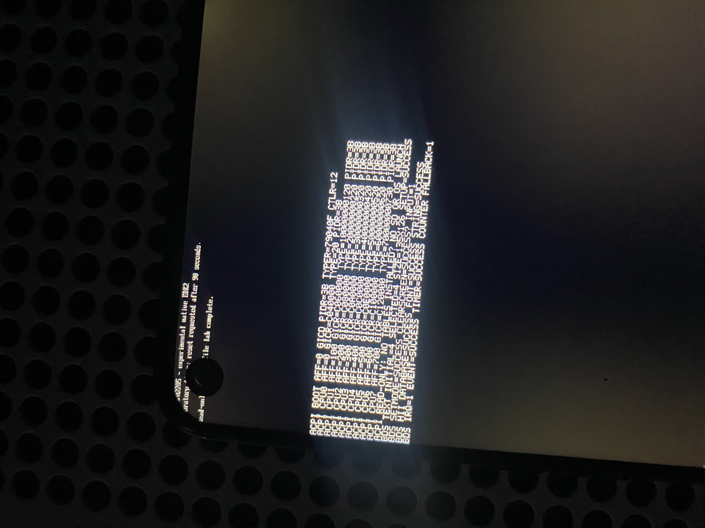
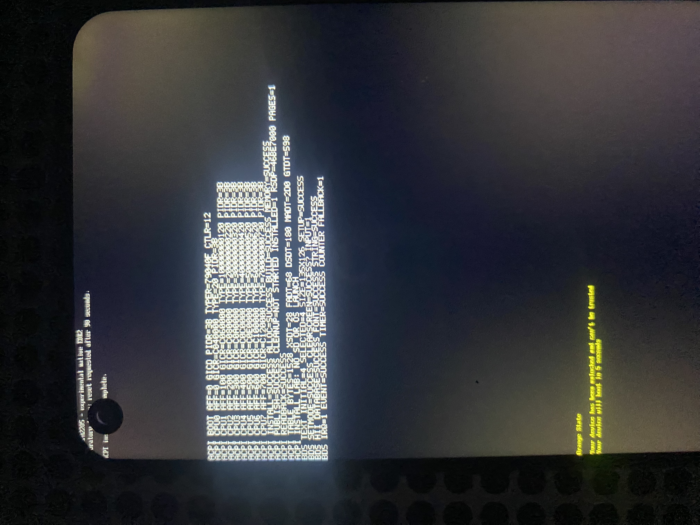
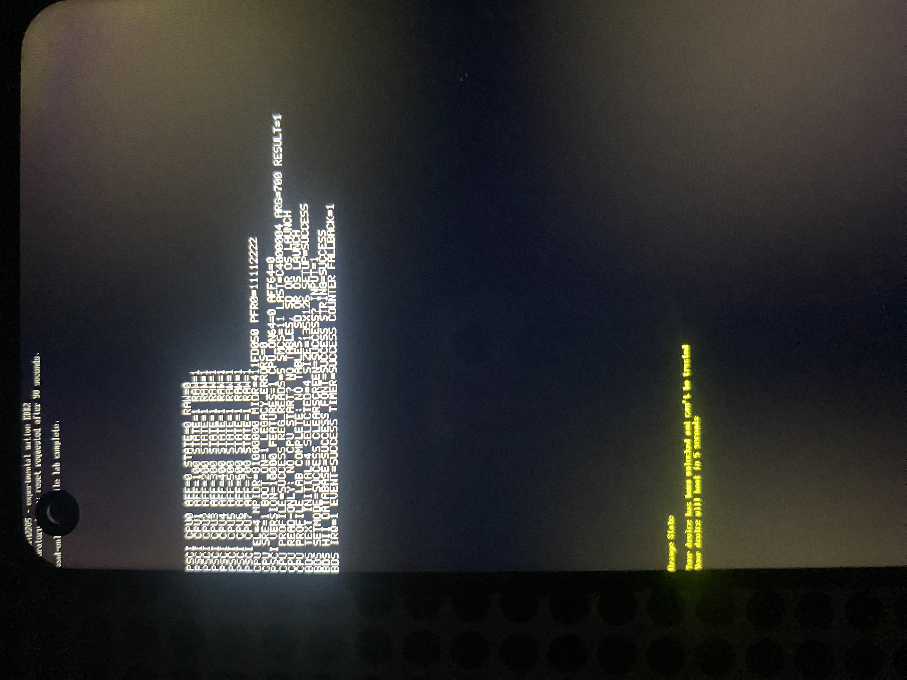

# Preparación ACPI: generador propio y observación GICv3

El intento físico 26 sigue mostrando Recovery de Windows `0xc0000225`.
Los contadores no registraron error de lectura ni reset de Block I/O durante
`StartImage`. No identifican el objeto que falta. La ausencia de ACPI en la
composición actual es un requisito de plataforma pendiente, **no una causa
demostrada de ese código**. Microsoft describe el uso de RSDP, MADT, GTDT y
DSDT por Windows en [sus requisitos de tablas ACPI](https://learn.microsoft.com/en-us/windows-hardware/drivers/bringup/acpi-system-description-tables).

`OppoAcpiLib` es un generador original de estructuras ACPI, comprobado en PC y
compilado como objeto ARM64. El intento 27 lo comprobó por separado; la variante
optativa 29 lo enlaza desde BDS para preparar su instalación. La ejecución de
esa instalación se observó en el intento 30, descrito más abajo. No incorpora tablas ni código de
otro port. Los formatos C genéricos son los de la dependencia EDK2 identificada.

## Datos y decisiones de formato

La [inspección del FDT capturado](../evidence/acpi-platform-prerequisites-26.json)
aporta ocho afinidades `0x000, 0x100, …, 0x700`, GICv3, temporizadores y PSCI
mediante SMC. Las afinidades proceden de `reg`: los nombres `cpu@100` y siguientes
no representan esos valores. La inspección adicional de `/pmu` obtuvo
`interrupts = <1 7 8>`: PPI 7, nivel bajo, INTID/GSIV 23. No se modificó el FDT.

El prototipo construye este conjunto en un búfer de 1528 bytes:

| Estructura | Contenido del prototipo |
| --- | --- |
| RSDP y XSDT | Punteros físicos de 64 bits y ambos checksums de RSDP. |
| FADT, revisión 6 | Hardware reducido, PSCI SMC, perfil tablet y puntero a DSDT; sin FACS ni registros PM inventados. |
| DSDT, revisión 2 | Ocho dispositivos CPU `ACPI0007` bajo `\_SB`, `_UID` entero y `_STA`; sin métodos ni OperationRegions. |
| MADT, revisión 4 | Ocho GICC, CPU de arranque primero, un GICD v3 y mantenimiento GSIV 25. |
| GTDT, revisión 2 | GSIV 29/30/27/26, nivel bajo, sin garantía de always-on ni contadores MMIO publicados. |

Los dispositivos CPU y sus UID siguen el [modelo de declaración de procesadores](https://uefi.org/htmlspecs/ACPI_Spec_6_4_html/08_Processor_Configuration_and_Control/declaring-processors.html).
La [especificación ACPI, capítulo 5](https://uefi.org/specs/ACPI/6.4_A/05_ACPI_Software_Programming_Model.html)
define los punteros, checksums, FADT, MADT y GTDT. Se usan `UINT64_MAX` para
los dos contadores MMIO opcionales no suministrados y flags de temporizador
`2` para nivel bajo. El bit always-on queda a cero.

La biblioteca exige las direcciones individuales de redistributor como entrada;
**se capturaron físicamente en el intento 28**, descrito más abajo. Comprueba región, alineación,
solapamientos y afinidades únicas, pero no demuestra que una dirección pertenezca
a esa CPU. Las pruebas usan una asociación sintética declarada como tal, incluso
desordenada, para detectar una asignación accidental por índice.

El prototipo no publica una estructura GICR de descubrimiento porque no se ha
demostrado que todos los redistributors estén en un dominio siempre encendido.
Describe GICC individuales. Los campos de compatibilidad GICv2 son cero; antes
de entregar las tablas a un OS hay que confirmar ese contrato. El tercer rango
del nodo GIC se clasificó documentalmente en el intento 28; no se interpreta
`0x0c53a650` como una interfaz GICC.

## Comprobación y trabajo pendiente

```console
EDK2_HEADERS=/ruta/a/edk2 bash scripts/test_acpi.sh
```

La comprobación ejecuta el generador con ASan/UBSan, cada tamaño de búfer
insuficiente, perfiles inválidos o superpuestos, memoria de salida con canarios,
CPU de arranque distinta y direcciones de tablas por encima de 4 GiB.
Un lector Python independiente valida bytes, revisiones, punteros, longitudes,
checksums, IRQ y campos reservados. ACPICA interpreta y recompila la DSDT con
cero errores y advertencias; su intérprete evalúa los UID extremos y `_STA`.
El objeto ARM64 solo depende de `CopyMem` y `ZeroMem`.
Véase [la evidencia de PC](../evidence/acpi-serialization-host-validation-27.json).

La correspondencia GICR/afinidad se observó en el intento 28 y quedó enlazada
con el generador usando el FDT y los registros de cada arranque en el 29/30.
Falta revisar CPU/PSCI antes de habilitarlas para un OS. El intento 30 verificó
reserva `EfiACPIReclaimMemory`, punteros físicos y publicación del RSDP después
de construir todas las tablas.
También faltan SMBIOS, tiempo RTC y la descripción y control de otros dispositivos.
Estas tablas mínimas no certifican compatibilidad con Windows ni arranque de WinPE.
La preparación del generador (27) no operó sobre el teléfono; el observador
separado (28) sí se ejecutó físicamente.

## Observador GICv3 separado (28)

`OppoAcpiProbeLib` valida primero CPU, GIC, temporizador, PMU y PSCI del FDT
recibido. También comprueba celdas, traducción de direcciones y padres de las
interrupciones seleccionadas. Una incompatibilidad impide cualquier lectura
de registros. Los nombres de los nodos CPU no determinan su afinidad.

Después lee exclusivamente PIDR2/TYPER/CTLR del distribuidor y PIDR2/TYPER de
los redistributors. Exige arquitectura GICv3, tipos estables en dos lecturas,
ocho afinidades únicas que coincidan con el FDT y el indicador `Last`. Rechaza
VLPIs antes de avanzar con un tamaño de frame incompatible. El orden de salida
sitúa primero la CPU ejecutora, sin suponer que el orden físico coincide con
`MPIDR_EL1`. Los campos se contrastaron con la documentación de
[Arm GICv3](https://documentation-service.arm.com/static/601412d54ccc190e5e681269)
y sus [reglas de afinidad](https://documentation-service.arm.com/static/5f1068720daa596235e7f6ef).

La referencia de [MT6779 en Linux](https://github.com/torvalds/linux/blob/6f771ce6c3bb2c4dc9d348b578871c7adb8b285b/arch/arm64/boot/dts/mediatek/mt6779.dtsi#L133)
describe `0x0c53a650/0x50` como controlador de polaridad, separado de GICD/GICR.
Esto aporta una clasificación documental del tercer rango del FDT del OPPO;
no prueba compatibilidad GICv2 ni un controlador Windows para esa polaridad.
El observador no accede a ese rango ni a los registros de habilitación,
prioridad, enrutamiento o energía de GIC.

El modo `NATIVE_ACPI_PROFILE_LAB=1` es optativo y no se combina con los
laboratorios SD o las sondas SEC. SEC entrega una referencia al FDT ya protegido
en un HOB separado; BDS valida ese HOB, muestra el resultado y solicita retorno
a los 90 segundos. No inicia Shell, microSD o Windows ni instala tablas ACPI.
El inspector y el empaquetador comprueban el marcador, el plazo y la ausencia
del controlador SD en el FD. El manifiesto conserva ese modo explícitamente.

Las pruebas de PC cubren 32 FDT negativos, el FDT real capturado con registros
simulados, afinidades desordenadas, 43 puntos de fallo de lectura, identidades
inestables, límites del HOB y la lista exacta de direcciones permitidas. BDS
pasa 42 escenarios de consola/plazo/despacho y el empaquetador rechaza modos
incompatibles. La imagen ARM64 compiló en 33,576 segundos con las opciones
emitidas por EDK2 comprobadas.

### Resultado físico del intento 28

La fotografía muestra la CPU ejecutora con afinidad `0x000`, GICD PIDR2 `0x3b`,
TYPER `0x0079040f` y CTLR `0x12`, seguidos de estas ocho asociaciones:

| UID | Afinidad | Base GICR | GICR_TYPER |
| --- | --- | --- | --- |
| 0 | `0x000` | `0x0c040000` | `0x0000000000000020` |
| 1 | `0x100` | `0x0c060000` | `0x0000010000000120` |
| 2 | `0x200` | `0x0c080000` | `0x0000020000000220` |
| 3 | `0x300` | `0x0c0a0000` | `0x0000030000000320` |
| 4 | `0x400` | `0x0c0c0000` | `0x0000040000000420` |
| 5 | `0x500` | `0x0c0e0000` | `0x0000050000000520` |
| 6 | `0x600` | `0x0c100000` | `0x0000060000000620` |
| 7 | `0x700` | `0x0c120000` | `0x0000070000000730` |

Todos los PIDR2 de redistributor muestran `0x3b`; el último TYPER tiene `Last`.
La línea inicial `ACPI PROFILE` quedó fuera del registro visible. El código
revisado solo imprime las ocho entradas cuando termina correctamente toda
la validación; la fotografía también muestra la finalización del laboratorio.
Esto verifica la asociación de registros y afinidades, sin demostrar ejecución
de las CPU secundarias, entrega de interrupciones ni dominios de energía.

El propietario observó la pantalla fija y después un reinicio. ADB detectó
Android con arranque completo; después se restauró el recovery original y se
verificó Android de nuevo, con batería al 100 % antes y después. El intervalo
de 201,281 segundos hasta la detección incluye LK y Android y no mide el plazo
nativo de 90 segundos. Esta variante no instaló tablas ni lanzó Windows, por
lo que no cambia el resultado pendiente de WinPE.



Véase [la transcripción y el retorno físico](../evidence/acpi-gic-profile-lab-28-validation.json).
Véase [la composición y las comprobaciones 28](../evidence/acpi-gic-profile-lab-28-host-validation.json).

## Instalación ACPI separada (29): validación en PC

`OppoAcpiInstallLib` reserva páginas `EfiACPIReclaimMemory`, construye las seis
estructuras con punteros físicos y comprueba que el mapa UEFI cubra toda la
reserva con ese tipo de memoria. Solo entonces publica el RSDP con el GUID
ACPI 2.0+ mediante `InstallConfigurationTable`. Después vuelve a localizar la
entrada y comprueba las firmas, los punteros y los checksums de las tablas.
Estas operaciones siguen los contratos de [memoria y tablas UEFI](https://uefi.org/specs/UEFI/2.10/04_EFI_System_Table.html)
y [publicación de configuración](https://uefi.org/specs/UEFI/2.10_A/07_Services_Boot_Services.html#efi-boot-services-installconfigurationtable).

Una entrada ACPI existente impide sustituirla. Un fallo previo a la publicación
libera las páginas y conserva el resultado de la limpieza. Tras publicar,
la memoria se conserva incluso si la comprobación posterior detecta daños,
para evitar punteros colgantes. Los buffers temporales del mapa se liberan;
el código limita su tamaño y el número de reintentos.

El perfil no se copia de la fotografía como una constante de producción:
se obtiene de nuevo del FDT y de GIC en cada arranque. La validación añade una
comprobación de que el phandle GIC tenga una única definición; rechaza alias
`linux,phandle` contradictorios antes de acceder a registros.

`NATIVE_ACPI_PROFILE_LAB=1 NATIVE_ACPI_INSTALL_LAB=1` selecciona esta variante.
El segundo flag sin el primero se rechaza. SEC y BDS comprueban la combinación,
y el inspector/manifiesto distinguen instalación de observación de solo lectura.
Se conservan el plazo de 90 segundos y la exclusión de SD, Shell y Windows.
El modo normal no publica estas tablas.

Las pruebas ejecutan el serializador e instalador reales con servicios UEFI
simulados: 26 escenarios de reserva, mapa con stride ampliado, reintentos,
conflictos, liberación, publicación y daños posteriores. También vuelven a
comprobar las tablas con un lector independiente y ACPICA. El enlace BDS pasa
14 escenarios de HOB/PCD y 56 de consola/despacho; el perfil FDT rechaza 35
árboles sintéticos incorrectos y acepta la captura privada con MMIO simulado.
Ninguno de esos modelos demuestra ejecución física del instalador ni arranque
de Windows. CPU/PSCI, dominios de energía, SMBIOS, RTC y dispositivos siguen
requiriendo trabajo; `0xc0000225` continúa sin causa demostrada.

La compilación final de esta variante terminó en 18,722 segundos, con ocho
módulos por cuatro tareas de objetos y 32 CPU lógicas disponibles. El candidato
privado pasó la validación de contenedor y manifiesto; no se ha solicitado su
ejecución física. Véase [la evidencia de PC del 29](../evidence/acpi-install-lab-29-host-validation.json).

## Comprobación de forma y revisión (30)

Una nueva prueba de PC reprodujo una aceptación incorrecta en la lectura
posterior del 29: una MADT reducida a su cabecera, con checksum recalculado,
pasaba esa comprobación aunque ya no contuviera las ocho CPU y el distribuidor.
El verificador ahora exige las longitudes y revisiones concretas del conjunto
que produce este instalador, además de límites, firmas, punteros y checksums.
También rechaza una GTDT con revisión distinta aunque su checksum sea válido.

Los 28 escenarios del instalador pasan con ASan/UBSan, incluidos esos dos casos.
La compilación ARM64 final terminó en 17,286 segundos y el nuevo contenedor
privado pasó su validación. El candidato 29 se sustituyó antes de ejecutarse en
el teléfono. El 30 conserva el perfil de cada arranque, las seis tablas y el
laboratorio sin SD, Shell ni Windows, con solicitud de reinicio a los 90 segundos.

### Resultado físico del intento 30

Tras la confirmación del propietario y los controles de identidad y batería al
100 %, el candidato arrancó directamente. La fotografía muestra `SUCCESS` en
`ACPI INSTALL`, `ALLOC`, `BUILD`, `MEMORY`, `PUBLISH` y `READBACK`, con `INSTALLED=1`.
Se publicaron RSDP, XSDT, FADT, DSDT, MADT y GTDT: 1528 bytes en una página de
4096 bytes. `CLEANUP=NOT STARTED` es el resultado esperado al conservar la
reserva publicada. El RSDP de esta ejecución está en `0x46be7000`; esa dirección
procede del asignador UEFI y puede variar entre arranques.

| Tabla | Desplazamiento hexadecimal desde la base |
| --- | --- |
| XSDT | `0x28` |
| FADT | `0x68` |
| DSDT | `0x180` |
| MADT | `0x2d0` |
| GTDT | `0x598` |

Las ocho asociaciones GICR/afinidad coinciden con la fotografía 28. El firmware
comprobó la cobertura de memoria reclaim, la entrada de configuración y las
firmas, longitudes, revisiones, punteros y checksums. No se recogió un volcado
físico independiente de las tablas; la prueba visible es su comprobación nativa.

ADB detectó Android con arranque completo y motivo `reboot` a los 197,83 segundos
del informe de entrada, intervalo que incluye LK y Android. No mide el plazo
nativo ni confirma intervención o ausencia de botones. Después se restauró el
recovery original y se verificó Android, con batería al 100 %. Esta variante no
inició SD, Shell ni Windows, y no demuestra aún arranque de WinPE ni la causa
del error anterior `0xc0000225`.



Véase [la transcripción y restauración](../evidence/acpi-install-shape-lab-30-validation.json)
y [la composición exacta del candidato](../evidence/acpi-install-shape-lab-30-host-validation.json).

## Observación CPU/PSCI de solo lectura (31)

La biblioteca original `OppoCpuProbeLib` comprueba el perfil de afinidades y
el procesador que ejecuta el firmware antes de consultar PSCI. El enlace nativo
lee CurrentEL, MPIDR, MIDR, PFR0 y SRE del EL actual, con seis instrucciones MRS
en la ruta completa: la selección de SRE vuelve a leer CurrentEL. PFR0 debe
anunciar la interfaz de registros GIC antes de acceder a SRE. Los seis helpers
ARM64 propios contienen únicamente MRS/RET; no escriben registros.

La lista permitida de llamadas SMC contiene `PSCI_VERSION`, `PSCI_FEATURES`
para CPU_ON64/AFFINITY_INFO64 y ocho consultas AFFINITY_INFO64 de nivel cero.
Consultar el soporte de CPU_ON no ejecuta CPU_ON. El enlace rechaza las
llamadas que arrancan, suspenden o apagan CPU, así como argumentos no revisados,
y pone a cero los argumentos SMC sin usar. La política preserva el resultado
crudo de afinidad y distingue errores negativos de 64 bits de implementaciones
antiguas que los extienden con ceros desde 32 bits. Una consulta completa puede
terminar en `SUCCESS` aunque el firmware devuelva un error PSCI reconocido;
el estado de cada servicio se registra por separado.

El modo optativo se selecciona con
`NATIVE_ACPI_PROFILE_LAB=1 NATIVE_CPU_PROFILE_LAB=1`. Primero pasa la validación
FDT/GIC del mismo arranque. No se combina con instalación ACPI, RAM adicional,
laboratorios SD o sondas SEC, y no inicia Shell ni Windows. El inspector y el
manifiesto exigen su marcador exclusivo y un plazo de 90 segundos. «Solo
lectura» describe el nuevo observador; el firmware conserva la inicialización
GIC/temporizador de la dependencia EDK2.

Las pruebas con ASan/UBSan cubren 16 escenarios de observación, 16 posiciones
de fallo de callback, perfiles incorrectos, alias y conservación del resultado
ante error. El enlace real se comprueba con registros/SMC simulados en EL1 y
EL2, argumentos sin usar y rechazo de llamadas no permitidas. Se revisó el
desensamblado ARM64, pasaron 16 escenarios de HOB/PCD, 70 de BDS y 21 pruebas
Python de inspección/empaquetado. La compilación nativa tardó 26,254 segundos;
se verificaron los PCD emitidos y las fuentes congeladas del candidato.

### Resultado físico del intento 31

Con batería al 100 %, la fotografía muestra el observador completo:

| Campo | Valor observado |
| --- | --- |
| CurrentEL / MPIDR / MIDR | `0x4` (EL1) / `0x81000000` / `0x411fd050` |
| ID_AA64PFR0_EL1 / ICC_SRE_EL1 | `0x11112222` / `0x1` |
| PSCI_VERSION | `0x00010000` (1.0) |
| PSCI_FEATURES para CPU_ON64 / AFFINITY_INFO64 | `0` / `0` |
| Afinidad `0x000` (CPU0) | Estado `0`, resultado crudo `0` |
| Afinidades `0x100` a `0x700` (CPU1–7) | Estado `1`, resultado crudo `1` en todas |
| CPU PROFILE / lecturas lógicas / consultas SMC | `SUCCESS` / `5` / `11` |
| Última llamada / argumento / resultado | `0xc4000004` / `0x700` / `1` |

Según [Arm PSCI, secciones 5.7 y 5.15](https://documentation-service.arm.com/static/640f584656ea36189d4e94a4),
las consultas anuncian soporte de esas dos interfaces y reportan CPU0 ON y las
otras siete OFF. Es la visión del firmware PSCI en ese instante, no una medición
eléctrica. No se ha probado CPU_ON, ejecución secundaria ni entrega de
interrupciones. SRE corresponde aquí a EL1, no a una suposición sobre EL2.
Estos resultados reducen incertidumbre del contrato de plataforma; no
identifican la causa de `0xc0000225` ni prueban arranque de WinPE.

El propietario confirmó que volvió solo a Android. El observador ADB detectó
arranque completo y motivo `reboot` a los 196,033 segundos desde el informe de
entrada; ese intervalo incluye LK y Android y no mide el plazo nativo. Se
restauró después el recovery original y se verificó Android con batería al 100 %.



Véanse [la transcripción y restauración](../evidence/cpu-psci-profile-lab-31-validation.json),
[la compilación y comprobaciones de PC](../evidence/cpu-psci-profile-lab-31-host-validation.json)
y [la revisión de la fotografía](../evidence/cpu-psci-profile-lab-31-photo.json).

## Variante combinada ACPI y microSD (32): comprobada en PC

`NATIVE_SD_ACPI_BOOT_LAB=1` habilita un intento distinto de los observadores
anteriores. Exige los laboratorios SD boot, alimentación, lectura rápida y RAM
adicional, y rechaza los modos aislados ACPI/CPU y las sondas SEC. Conserva
el plazo experimental de 1800 segundos y el controlador Block I/O de solo
lectura. El modo normal y las variantes anteriores conservan su comportamiento.

SEC entrega también el HOB del FDT protegido en esta variante. Antes del intento
de arranque SD, BDS vuelve a validar el perfil FDT/GIC y consulta el contrato CPU.
Exige EL1, SRE habilitado, PSCI 1.x con CPU_ON64/AFFINITY_INFO64 anunciados,
CPU de arranque ON y las otras siete OFF. Después instala las tablas originales
y exige éxito tanto de publicación como de lectura posterior. Un fallo o un
resultado distinto de éxito bloquea la llamada al laboratorio de arranque SD;
no hay una ruta de respaldo que omita las comprobaciones. La consulta CPU
conserva su lista de llamadas de solo lectura y no ejecuta CPU_ON.

Las pruebas pasan 10 casos del contrato CPU, ocho de la transacción previa a
SD y 98 de BDS, incluyendo fallo de plataforma, consola y plazo. Los 16 casos
de enlace FDT/HOB siguen pasando. Hay 23 pruebas Python de contenedor/manifiesto
y siete combinaciones de compilación incorrectas rechazadas antes del build.
Las comprobaciones de C usan ASan/UBSan y callbacks simulados. El candidato
ARM64 compiló en 25,248 segundos, con PCD efectivos contrastados en SEC, BDS,
runtime y SD; el empaquetado privado y su marcador exclusivo se verificaron.

Esto demuestra preparación y pruebas de PC. La ejecución de esta combinación
en el OPPO está pendiente; no se presume que Windows vaya a consumir las tablas
correctamente ni que desaparezca `0xc0000225`. SMBIOS, RTC, entrega de
interrupciones y ejecución secundaria mantienen sus límites anteriores.
Véase [la composición y validación de PC del 32](../evidence/sd-acpi-boot-lab-32-host-validation.json).
