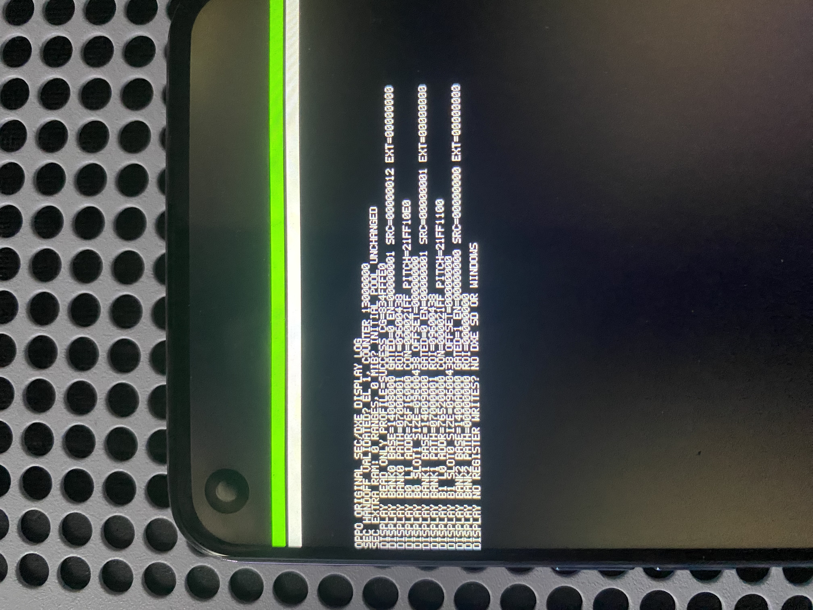
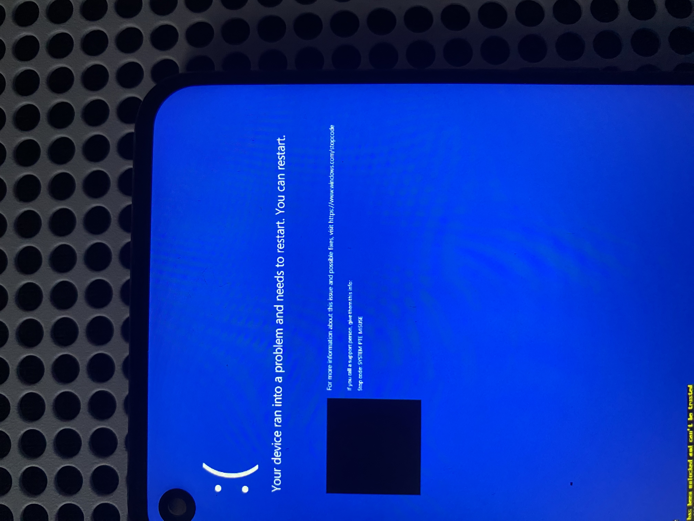

# Pantalla heredada y Orange State

El GOP propio utiliza el framebuffer reservado que entrega LK. El aviso Orange
State permanece visible sobre Windows en las fotos del intento 35. Eso no
demuestra que sea parte del framebuffer que utiliza GOP; hay que comprobar las
superficies de composición activas antes de modificar la presentación.

## Sonda de lectura SEC (36)

`NATIVE_DISPLAY_PROBE=1` selecciona una variante corta separada de las sondas
de entrada/MMU y de los laboratorios SD, ACPI y CPU. Antes de leer registros
comprueba el binding vivo de MMSYS y los tres bancos OVL: compatibles, recursos
exactos de 4 KiB, estado habilitado, celdas de dirección/tamaño y traducción
identidad del bus. Omite bancos con reloj apagado y capas deshabilitadas.
No desreferencia las direcciones de las superficies ni escribe registros de
pantalla. Tras mostrar los datos solicita reset PSCI a los diez segundos;
no entra en DXE, la Shell, SD ni Windows. El reset no es un rescate garantizado
ante una excepción o bloqueo del bus.

Los contratos de registros y relojes se investigaron en la revisión fijada de
OPPO: [registros OVL](https://github.com/oppo-source/android_kernel_oppo_mt6779/blob/0e1e01b9fb281b02d1f50f12ea475d881f3fafd5/drivers/misc/mediatek/video/mt6779/dispsys/ddp_reg_ovl.h),
[recursos de pantalla](https://github.com/oppo-source/android_kernel_oppo_mt6779/blob/0e1e01b9fb281b02d1f50f12ea475d881f3fafd5/drivers/misc/mediatek/video/mt6779/dispsys/ddp_info.c)
y [relojes MMSYS](https://github.com/oppo-source/android_kernel_oppo_mt6779/blob/0e1e01b9fb281b02d1f50f12ea475d881f3fafd5/drivers/clk/mediatek/clk-mt6779-mm.c).
El lector, las comprobaciones y los modelos de prueba son código propio.



La [foto revisada](../evidence/display-profile-probe-36-photo.json) confirma
perfil correcto, EL1 y dos bancos activos. La transcripción seleccionada es:

| Banco/capa | Dirección | Control | Pitch | Tamaño | Desplazamiento |
| --- | --- | --- | --- | --- | --- |
| OVL0 L1 | `0x76f16000` | `0x000021ff` | `0x21ff10e0` | `0x09600438` | `0` |
| OVL0_2L L0 (GOP) | `0x76520000` | `0x000031ff` | `0x21ff1100` | `0x09600438` | `0` |

OVL0 declara `SRC=0x12` y OVL0_2L `SRC=1`; ambos tienen `EXT=0`,
`PATH=0x07000001` y `ROI=0x09600438`. El tercer banco tiene el reloj apagado
y no fue leído. El valor hexadecimal completo de CG no se acepta como
transcripción verificada. La imagen identifica las superficies; no prueba qué
píxeles contiene cada una ni que Orange State haya desaparecido.

La entrada se solicitó con batería al 100 %. ADB detectó Android completo con
motivo `reboot` a los 118,643 segundos desde el informe de entrada; ese tiempo
incluye LK, la sonda y Android, y no mide los diez segundos de espera del código.
Después se restauró el recovery original y se comprobó Android al 100 %.
La tarjeta conservó sus archivos originales durante esta fase.
Véase [la validación física y de PC](../evidence/display-profile-probe-36-validation.json).

## Limpieza condicionada y resultado físico (37)

La implementación de la variante 37 vuelve a leer y comprobar la configuración
observada. Solo si coincide intenta cambiar `OVL0 SRC_CON` de `0x12` a `0x10`:
deshabilita L1 y conserva la entrada LC, así como todos los registros de la
superficie GOP. Comprueba el valor inmediatamente antes y después de escribir.
No cambia direcciones de framebuffer, pitch, formatos, relojes, temporización,
memoria de píxeles, almacenamiento ni estado de bloqueo del bootloader.

Solo se selecciona en el laboratorio de arranque SD; la sonda de lectura sigue
sin escrituras de pantalla. Los modelos de PC rechazan perfiles diferentes,
fallos de lectura, cambios concurrentes y errores de escritura/readback. La
compilación de la variante 37 no prueba el efecto visual. Véase
[la preparación de PC](../evidence/display-clean-boot-lab-37-host-validation.json).



La [foto del intento 37](../evidence/display-clean-boot-lab-37-photo.json) muestra
`SYSTEM_PTE_MISUSE`; parte del aviso amarillo heredado sigue visible en el borde
inferior y el propietario confirma que Orange State persistió. No se capturó
`DISPLAY HANDOFF CLEAN`, por lo que no se sabe si se aplicó la escritura o
si el perfil se rechazó. No se da por eliminada la capa.

El medio oficial WinPE es el mismo del 35, con sus 89 archivos comprobados en la
tarjeta antes del intento. La variante de firmware es diferente; que cambie
el nombre del bugcheck no identifica su causa. No hay cuatro parámetros
numéricos, pila ni volcado para atribuir el fallo a una PTE, un controlador o
la GPU. ADB detectó Android con motivo `PowerKey` a los 537,432 segundos
desde el informe de entrada, después de que el propietario anunciara el
reinicio forzado; el intervalo incluye toda la espera y no mide el arranque
de Windows. Después se restauró el recovery original y se comprobaron por
SHA-256 los 681 archivos originales de la tarjeta; Android quedó al 100 %.
El medio oficial de prueba se conserva separado. Véase [el resultado físico y la restauración](../evidence/display-clean-boot-lab-37-validation.json).

Las comprobaciones de PC se ejecutan con:

```console
EDK2_HEADERS=/ruta/a/edk2 bash scripts/test_display_probe.sh
```
