# microSD nativa: lectura física y arranque EFI experimental

Se está implementando un lector propio para MSDC1 del MT6779. La meta es abrir
el cargador ARM64 de una tarjeta preparada por el propietario y después ejecutar
Windows Boot Manager. La presencia de un archivo EFI no demuestra que Windows PE
pueda arrancar: aún faltan validaciones de memoria, ACPI y otros dispositivos.

## Evidencia y límites actuales

- Android montó la tarjeta como vfat y permitió leer la cabecera de
  `EFI/BOOT/BOOTAA64.EFI`: PE ARM64 (`0xaa64`), aplicación UEFI (`10`). Esa lectura
  se hizo desde Android; no es una validación del lector EDK2.
- `OppoMsdcLib` enumera SDHC/SDSC y lee sectores con CMD17 mediante PIO, en un bit,
  sin DMA. Con fuente de 26 MHz utiliza aproximadamente 382 kHz para enumerar y
  6,5 MHz para leer. No implementa comandos de escritura ni borrado.
- `OppoSdDxe` comprueba el HOB de perfil y conserva el pinmux existente. Selecciona
  el reloj de MSDC1, prepara sus entradas en IOCFG_RM y publica Block I/O de solo lectura si la tarjeta
  responde. Los fallos se exponen mediante un protocolo de diagnóstico propio.
- La variante ARM64 `sd-read-lab` compiló y llegó físicamente al diagnóstico BDS.
  Su primer intento se detuvo en un error de CRC de respuesta a CMD8; no terminó
  la enumeración ni publicó Block I/O. El intento 16, con alimentación explícita,
  descubrió el filesystem FAT, abrió `BOOTAA64.EFI` y leyó sus primeros 4096 bytes
  desde la microSD en EDK2. Su encabezado ARM64 UEFI pasó la comprobación.
  Esa variante no ejecuta Windows.

## Primer intento físico (08)

La fotografía del propietario permite leer:

```text
SD PROFILE=SUCCESS BOARD=SUCCESS INIT=CRC ERROR PUBLISH=NOT STARTED
SD PADS=1 MISC=00000000 MODE16=11111111 MODE17=11111111 MODE1=00040000
SD SECTORS=0 LAST CMD=8 INT=00000400
```

El bit de interrupción `0x400` corresponde a error de CRC de respuesta. Es un
resultado del controlador, no prueba de una respuesta válida de la tarjeta ni
un diagnóstico concluyente de su causa. La siguiente revisión investigará el
muestreo y los retardos heredados. No se omitirá la comprobación CRC.

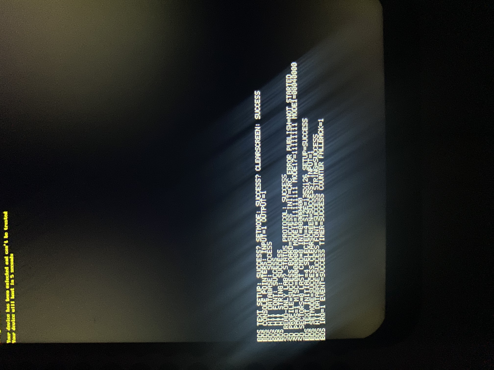

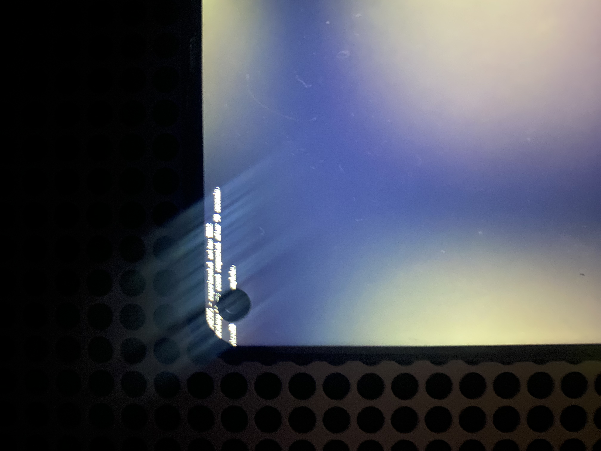

Ambas fotografías se conservaron sin recomprimir sus datos de imagen. Se
retiraron los metadatos de cámara, conservando orientación y perfil de color.
La segunda aporta contexto; su texto superior no permite otra conclusión SD.
Los resultados filtrados están en
[la evidencia física](../evidence/native-sd-read-lab-08-validation.json).

ADB volvió a detectar Android completo; después se restauró el recovery
original y se comprobó otra vez el arranque, con batería al 97 %. El observador
registró unos 196 segundos entre el informe de entrada y la detección de Android;
ese intervalo incluye LK, Android y sondeo USB. No mide los 90 segundos nativos
ni demuestra por sí solo el mecanismo exacto del reinicio.

La SEC valida las regiones de MSDC1, topckgen, infracfg y GPIO contra el FDT de
ese arranque antes de mapearlas como MMIO de dispositivo. No se inicializa MSDC0
ni se exploran otros discos desde el diagnóstico BDS. Los módulos genéricos
DiskIo, Partition y FAT de EDK2 suministran las capas de partición y filesystem;
el controlador específico MSDC y su enlace de plataforma son originales.

## Alimentación y pines

El FDT capturado en este CPH2205 declara MSDC1 en `0x11240000`, con suministro
VMCH desde `ldo5` y VMC desde `ldo3`, ambos bajo el regulador externo
`subpmic_ldo@64` del controlador I²C5. No son los reguladores principales MT6359.
La variante inicial conserva el estado de alimentación dejado por el cargador:
no escribe registros del regulador, no cambia voltaje y no adivina su chip.

El GPIO admite dos disposiciones documentadas para MSDC1. El controlador actual
solo prepara la disposición estándar observada en este OPPO; detecta y rechaza
la alternativa sin escribir sus pads, porque su banco no está validado aquí.
Un timeout de tarjeta por sí solo no identifica un problema de alimentación.

Los contratos de registros y reloj se investigaron en las fuentes públicas de
[OPPO MT6779, revisión fijada](https://github.com/oppo-source/android_kernel_oppo_mt6779/tree/0e1e01b9fb281b02d1f50f12ea475d881f3fafd5/drivers/mmc/host/mediatek/ComboA)
y su [controlador de relojes](https://github.com/oppo-source/android_kernel_oppo_mt6779/blob/0e1e01b9fb281b02d1f50f12ea475d881f3fafd5/drivers/clk/mediatek/clk-mt6779.c).
Son referencias de interfaces; no se importó su implementación.

## Comprobaciones de PC

Con `EDK2_HEADERS` apuntando a la dependencia base revisada:

```sh
bash scripts/test_msdc.sh
bash scripts/test_sd_binding.sh
bash scripts/test_sd_read.sh
bash scripts/test_sd_profile.sh
bash scripts/test_sd_power.sh
bash scripts/test_bds.sh
```

Las pruebas con ASan/UBSan cubren capacidad y direccionamiento SDHC/SDSC,
lecturas no alineadas, errores de CRC/timeout, esperas acotadas, exclusión de
escrituras y DMA, rechazo de perfiles no validados, readback de relojes y API
Block I/O. El diagnóstico de filesystem rechaza otras unidades y cabeceras PE
truncadas, de otra arquitectura o con offsets fuera del prefijo leído.
Son modelos de PC: no prueban señales eléctricas ni lectura física.

La segunda variante establece el muestreo común de lectura para SD legado y
limita el reintento de CMD8 a un segundo flanco de respuesta, únicamente después
de un CRC. Un segundo CRC o timeout detiene la enumeración; no se interpreta como
permiso para ignorar errores ni para reintentar lecturas de sectores fallidas.
También registra IOCON, CFG, PS y PAD_TUNE0 para comprobar el estado retenido.
La revisión compiló y pasó los modelos de PC; su prueba física mantuvo el error.

## Segundo intento físico (09)

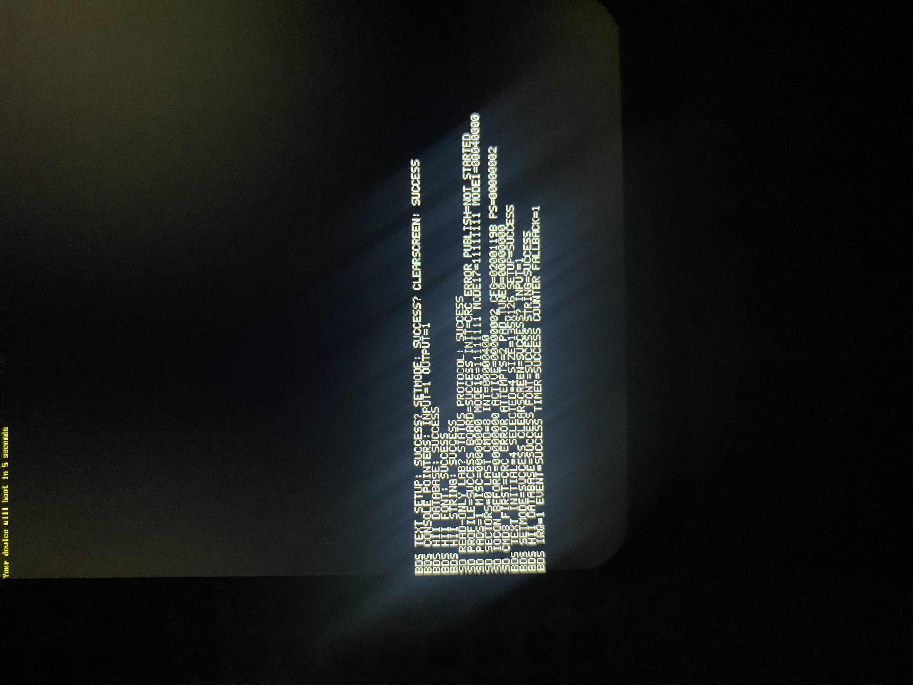

La fotografía muestra el mismo resultado de perfil, placa e inicialización del
primer intento, y añade:

```text
SD IOCON BEFORE=00000000 ACTIVE=00000002 CFG=0200119B PS=00000002
SD CMD8 FIRST=CRC ERROR ATTEMPTS=2 PAD_TUNE0=00000000
```

El IOCON inicial ya estaba en cero; el alternativo tampoco resolvió el CRC.
PS no muestra altos en los bits de DAT/CMD. La foto no distingue entre entradas
inhabilitadas, alimentación ausente u otra condición eléctrica; no se concluye
la causa. La siguiente comprobación será la habilitación de entrada y el estado
de los pads específicos, antes de alterar reguladores. No se leyeron sectores.
La imagen conserva sus datos comprimidos; solo se retiraron metadatos personales.
Véase [la evidencia de este intento](../evidence/native-sd-read-lab-09-validation.json).

## Tercer intento físico (10): asociación de banco incorrecta

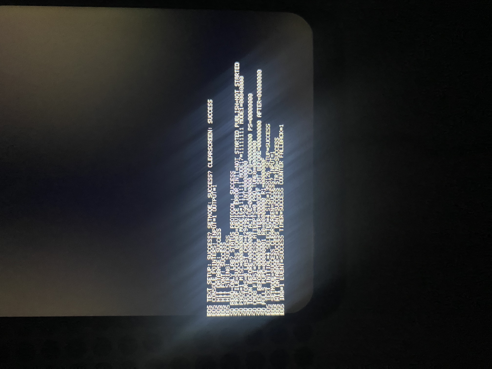

```text
SD PROFILE=SUCCESS BOARD=DEVICE ERROR INIT=NOT STARTED PUBLISH=NOT STARTED
SD IES BEFORE=00003DEF AFTER=00003DFF SMT BEFORE=00000000 AFTER=00000000
SD PULLS PUPD=00000001 R0=00000000 R1=0000010F
```

La comprobación de lectura posterior a la escritura detuvo la preparación antes
de inicializar MSDC. `LAST CMD=4294967295` es el centinela de no iniciado, no un
comando enviado. El `CMD8 FIRST=SUCCESS` con cero intentos era un valor inicial
engañoso del diagnóstico; no hubo una respuesta CMD8 correcta.

La implementación de este intento tomó `0x11e70000` de un comentario del header
de referencia. Fue un error: el código del fabricante resuelve MSDC1 mediante
`mediatek,iocfg_rm`, y el árbol activo lo sitúa en **`0x11c20000`**. El banco
`0x11e70000` corresponde a `iocfg_lb`. Que una dirección exista en `reg` no prueba
su asociación con el periférico. La tabla de pinctrl de MT6779 ubica GPIO
134–139 en banco 1, consistente con `iocfg_rm` y sus máscaras IES/SMT/pulls.

Se conservará este resultado como evidencia histórica. La corrección debe
comprobar nombre compatible y rango en el FDT, usar el banco RM y restaurar los
valores originales si falla el readback. Este intento no valida alimentación,
enumeración SD, lectura de sectores ni Windows. Los modelos de PC no detectaban
la asociación equivocada porque simulaban los registros seleccionados.
Véase [la evidencia filtrada](../evidence/native-sd-read-lab-10-validation.json).

Las referencias primarias son el
[mapeo de recursos de MSDC](https://github.com/oppo-source/android_kernel_oppo_mt6779/blob/0e1e01b9fb281b02d1f50f12ea475d881f3fafd5/drivers/mmc/host/mediatek/ComboA/mt6779/msdc_cust.c)
y la [tabla pinctrl MT6779](https://github.com/oppo-source/android_kernel_oppo_mt6779/blob/0e1e01b9fb281b02d1f50f12ea475d881f3fafd5/drivers/pinctrl/mediatek/pinctrl-mt6779.c).

## Cuarto intento físico (11): banco RM correcto, CMD8 todavía con CRC

`OppoSdProfileMatches` comprueba el rol compatible, rango y alias de `iocfg_rm`
en el FDT antes de mapear **`0x11c20000`** como MMIO. El HOB distingue esta
comprobación de la validación anterior por direcciones. Se conservaron como
historia las fuentes y la fotografía del intento 10; su banco LB no debe usarse
como referencia SD.

El controlador conserva los bits ajenos de los registros RM. Si falla el
readback de los pads, intenta restaurar sus cinco valores originales y verifica
la restauración. El diagnóstico inicia CMD8 como `Not Started` y la operación
síncrona de Block I/O se serializa en TPL_CALLBACK. El mapa de SEC reserva un
terminador y deriva su capacidad del tamaño real del arreglo de protecciones.

El validador aceptó el FDT privado capturado del OPPO. Las pruebas con el lector
FDT real rechazaron el rol equivocado aunque el rango existiera, el alias LB,
otro controlador, eMMC, otra anchura y estados inválidos. La simulación de
Block I/O cubre tanto restauración correcta como rechazada. La variante ARM64
compiló y se ejecutó en el OPPO.
Véase [la validación de PC](../evidence/native-sd-read-lab-11-host-validation.json).

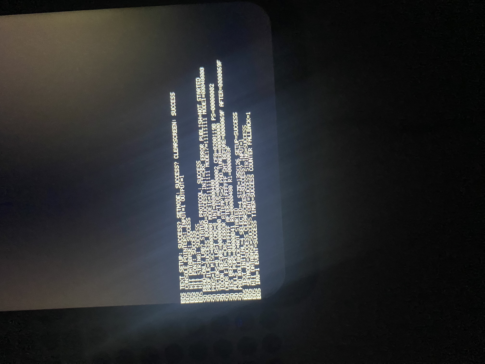

```text
SD PROFILE=SUCCESS BOARD=SUCCESS INIT=CRC ERROR PUBLISH=NOT STARTED
SD SECTORS=0 LAST CMD=8 INT=00000400
SD CMD8 FIRST=CRC ERROR ATTEMPTS=2
SD IES BEFORE=01FFFFFF AFTER=01FFFFFF SMT BEFORE=0000069F AFTER=000006BF
SD PULLS PUPD=00000B41 R0=00000480 R1=0000003F
SD PAD ROLLBACK=NOT STARTED
```

El readback de RM pasó; las entradas ya estaban habilitadas y los bits Schmitt
quedaron activados. No fue necesario restaurar los pads porque esa comprobación
no falló. Aun así, los dos flancos de respuesta dieron CRC y no se publicaron
sectores ni filesystem. Esta foto no demuestra que la tarjeta tenga alimentación.
Se investigará el acceso I²C5 al regulador externo mediante una consulta de sus
registros antes de plantear cambios de voltaje o habilitación.

Android volvió a estar completo unos 200 segundos después del informe de entrada,
intervalo que incluye el arranque y el sondeo USB. Se restauró el recovery
original y se verificó Android con batería al 99 %. La prueba comenzó al 100 %.
Véase [la evidencia física filtrada](../evidence/native-sd-read-lab-11-validation.json).

## Quinto intento físico (12): lectura I²C válida, restauración rechazada

La versión de la biblioteca original `OppoSdPowerLib` utilizada en el intento 12
consulta el chip y los registros VMC/VMCH. Esa variante no contiene una operación
de escritura de registros del regulador.
Usa PIO con un byte de índice y un repeated start; las únicas direcciones son
la PMU `0x34` para su identidad y LDO `0x64` para seis registros de estado.
La identidad debe tener el prefijo esperado antes de consultar LDO; cada byte
LDO se acepta únicamente con su CRC-8 válido. La máscara `valid` distingue los
valores realmente leídos de los campos que siguen sin validar.

El perfil FDT valida I²C5, su versión 2, FIFO de 8 bits, divisor 5, modo
push-pull, GPIO28/29 y los enlaces de suministro de MSDC1 a LDO3/LDO5.
SEC solo mapea la página de I²C5 cuando ese perfil coincide. El enlace comprueba
el pinmux y el reloj compartido sin modificarlos; puede habilitar y restaurar
exclusivamente la compuerta de I²C5. No toca DMA, otro bus ni el regulador principal.
Conserva la fuente del reloj y utiliza divisores de transferencia lentos.

La biblioteca rechaza un bus ocupado antes de escribir, limita las esperas y
restaura la configuración previa del controlador. Si no logra detener una
transferencia fallida o verificar la restauración, el diagnóstico marca el fallo.
No se interpreta una consulta fallida como prueba de que los rieles estén apagados.

Las pruebas de PC cubren diez escenarios de consulta, errores de CRC/NACK/timeout,
identidad incorrecta, bus ocupado y restauración fallida; además, 21 escenarios
del enlace de placa y nueve mutaciones nuevas del perfil de alimentación.
El FDT real capturado pasó el validador. La compilación ARM64 terminó en unos
12 segundos, con las fuentes sin cambiar durante el build. Esto no demuestra
lectura I²C física por sí solo; la fotografía siguiente sí permite observar
el resultado del intento 12.

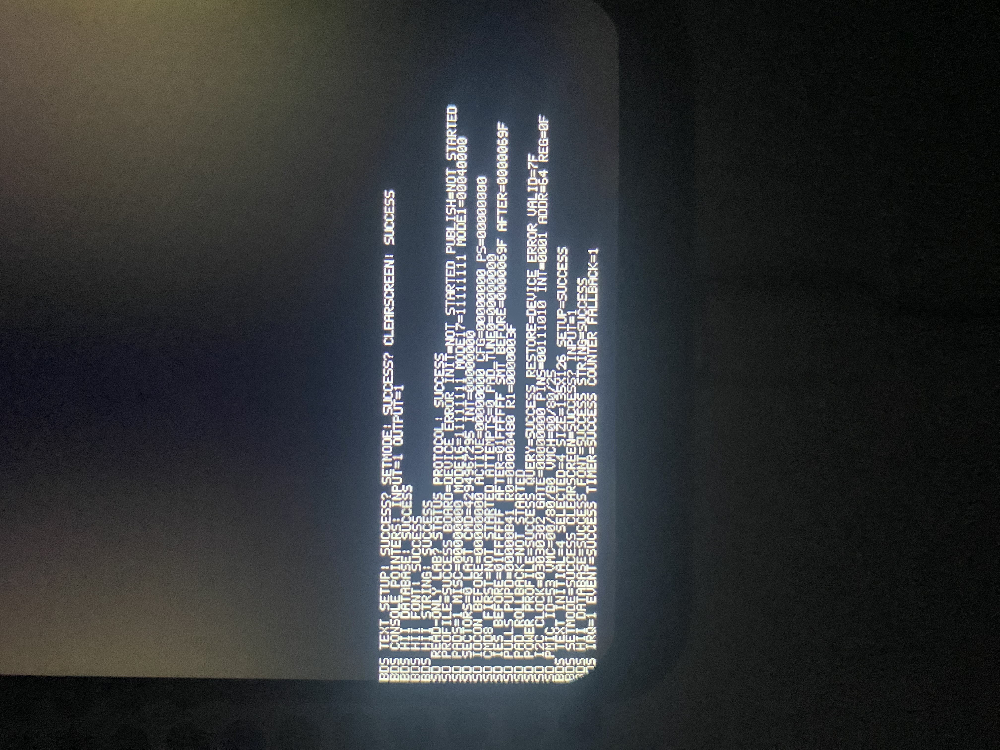

```text
SD PROFILE=SUCCESS BOARD=DEVICE ERROR INIT=NOT STARTED PUBLISH=NOT STARTED
SD POWER PROFILE=SUCCESS QUERY=SUCCESS RESTORE=DEVICE ERROR VALID=7F
SD I2C CLOCK=03030302 GATE=00000000 PINS=00111010 INT=0001 ADDR=64 REG=0F
SD PMIC ID=53 VMC=00/80/80 VMCH=00/80/25
```

`valid=7F` significa que la identidad de PMU y los seis bytes LDO se leyeron.
Cada byte LDO pasó CRC. Los bits de habilitación por software (`0x40`) y de
estado (`0x04`) están a cero en ambos registros de control 2 (`0x80`). Eso
describe el estado leído del regulador; no es una medida eléctrica de voltaje.
No se modificaron sus habilitaciones ni selectores de voltaje.

La restauración de la configuración I²C no pasó el readback. El guard detuvo
la fase antes de inicializar MSDC: el centinela de último comando y los cero
intentos CMD8 no son una nueva respuesta CRC de la tarjeta. No hay sectores,
filesystem ni Windows validados. La siguiente variante conservará ese guard y
mostrará el registro de restauración, el valor esperado y el observado para
investigar el desacuerdo sin omitir la comprobación.

El observador detectó Android completo unos 201 segundos después del informe de
entrada, incluyendo LK, Android y sondeo USB. Se restauró el recovery original
y se verificó Android con batería al 100 %. La fotografía conserva los datos
comprimidos originales, sin metadatos personales de cámara. Véase
[la evidencia física](../evidence/native-sd-read-lab-12-validation.json).

La variante 13 añade el registro exacto y sus valores esperado/observado al
diagnóstico de restauración, incluyendo un START que no se detenga y una
compuerta que no se restaure. Las pruebas de PC cubren esos reportes; compiló
para ARM64 en unos 12 segundos. Su composición está en
[la evidencia de compilación](../evidence/native-sd-read-lab-13-host-validation.json).

## Sexto y séptimo intentos (13–14): preservar HS sin reescribirlo

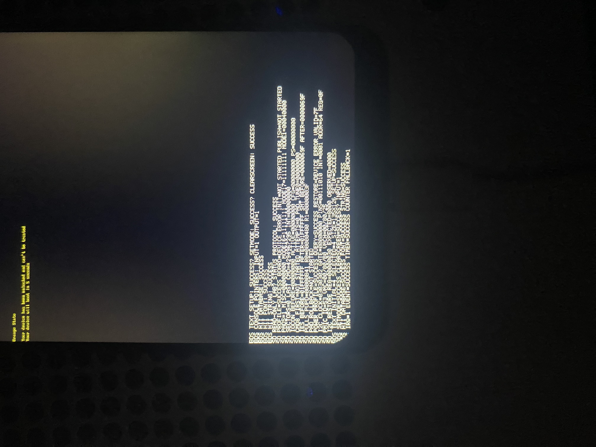

El intento 13 repitió las consultas válidas y mostró el desacuerdo:

```text
SD POWER PROFILE=SUCCESS QUERY=SUCCESS RESTORE=DEVICE ERROR VALID=7F
SD I2C RESTORE REG=00000030 EXPECTED=8000 OBSERVED=0000
```

El offset `0x30` es HS en esta versión del controlador. La consulta lo ponía en
cero y después intentaba reponer el valor retenido. No se ha establecido el
significado del bit `0x8000`; no debe declararse escribible ni ignorarse su cambio.
La variante 14 rechaza un modo HS activo y deja ese registro completamente sin
escribir, tanto durante la preparación como durante la restauración. Aun así,
su valor sigue formando parte del readback estricto. Las pruebas de PC reproducen
el valor retenido y comprueban que no haya ninguna escritura a HS.

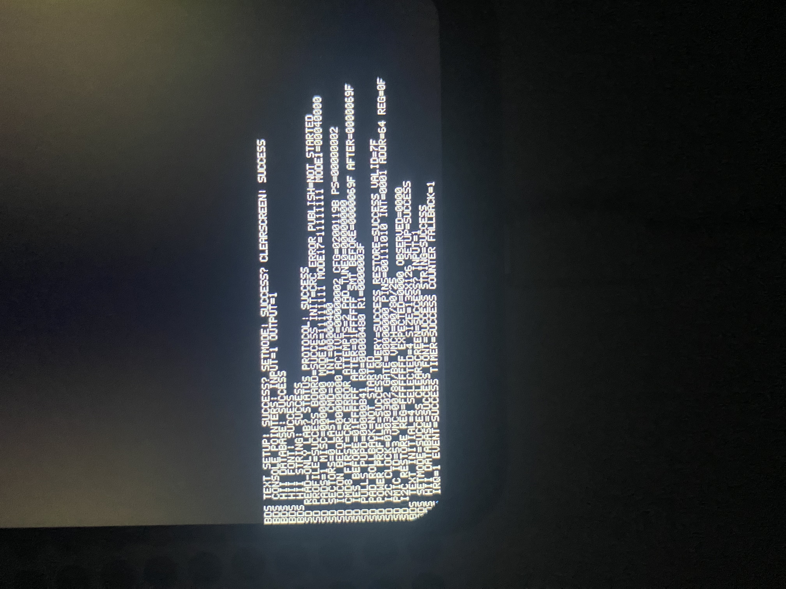

```text
SD PROFILE=SUCCESS BOARD=SUCCESS INIT=CRC ERROR PUBLISH=NOT STARTED
SD SECTORS=0 LAST CMD=8 INT=00000400
SD POWER PROFILE=SUCCESS QUERY=SUCCESS RESTORE=SUCCESS VALID=7F
SD PMIC ID=53 VMC=00/80/80 VMCH=00/80/25
SD I2C RESTORE REG=FFFFFFFF EXPECTED=0000 OBSERVED=0000
```

El centinela `FFFFFFFF` indica que no se encontró una diferencia de restauración.
La corrección sí pasó físicamente. Ambos bits de habilitación por software siguen
a cero; el próximo paso investigará el encendido de las dos salidas a 3,0 V,
según el contrato de MSDC, con lectura posterior y restauración ante fallo.
Ninguno de estos intentos escribe registros del regulador. No se ha leído un
sector ni se ha iniciado Windows. Las evidencias filtradas son
[13](../evidence/native-sd-read-lab-13-validation.json) y
[14](../evidence/native-sd-read-lab-14-validation.json).

El observador volvió a detectar Android completo en ambos intentos, unos 199 y
202 segundos después de sus informes de entrada, respectivamente; esos tiempos
incluyen LK, Android y sondeo USB. Tras cada intento se restauró el recovery
original y se verificó Android con batería al 100 %.

## Encendido VMC/VMCH (16): lectura física de la microSD conseguida

`NATIVE_SD_POWER_LAB=1` selecciona la variante separada `sd-power-lab`. El PCD
está desactivado por defecto. La consulta `OppoSdPowerInspect` conserva su
contrato sin escrituras LDO; la nueva operación explícita `OppoSdPowerEnable`
solo se usa cuando el FDT valida además los límites de voltaje de las dos salidas.
Un bit de HOB separado identifica esa comprobación. El perfil real del OPPO
declara 1,2–3,6 V para VMC y 2,7–3,6 V para VMCH.

La operación exige el estado deshabilitado observado, comprueba la identidad
del chip y guarda sus valores originales. Solo permite escribir `0x05`, `0x09`,
`0x0b`, `0x0c` y `0x0f` del esclavo LDO `0x64`. Los paquetes llevan CRC-8 y
padding según la interfaz documentada; cada cambio se comprueba con una lectura
protegida por CRC. No hay escritura de sectores, acceso a otros reguladores,
cambio del reloj compartido ni escritura a HS.

Los selectores se ajustan a 3,0 V mientras cada salida indica estar apagada.
Después se habilitan VMCH, detección de tarjeta y VMC, con esperas acotadas para
su estado de encendido. Si falla la aplicación, se intenta deshabilitar en orden
inverso y reponer los valores originales. Si no se confirma el apagado de una
salida, se conserva su selector de 3,0 V y se informa del fallo, sin cambiar su
voltaje mientras podría seguir activa. Un fallo de restauración I²C también
detiene MSDC, incluso si la aplicación de los rieles había terminado.

Los 21 escenarios de PC modelan paquetes exactos, estado inicial ajeno, CRC,
NACK, timeout, readback rechazado, estado de encendido que no llega, restauración
y la prohibición de cambiar un selector activo. El lector anterior conserva sus
11 casos; el enlace de placa pasó 26 casos y el FDT real fue aceptado, con cuatro
mutaciones nuevas de los límites de voltaje rechazadas. La composición ARM64
compiló en unos 27 segundos, con `PcdNativeSdPowerLab=TRUE` y
`PcdNativeSdBootLab=FALSE` verificados en AutoGen. La recuperación ante fallos
de alimentación sigue validada solo mediante modelos; no se inyectaron fallos
en el teléfono.
Véase [la validación de PC](../evidence/native-sd-power-lab-16-host-validation.json).

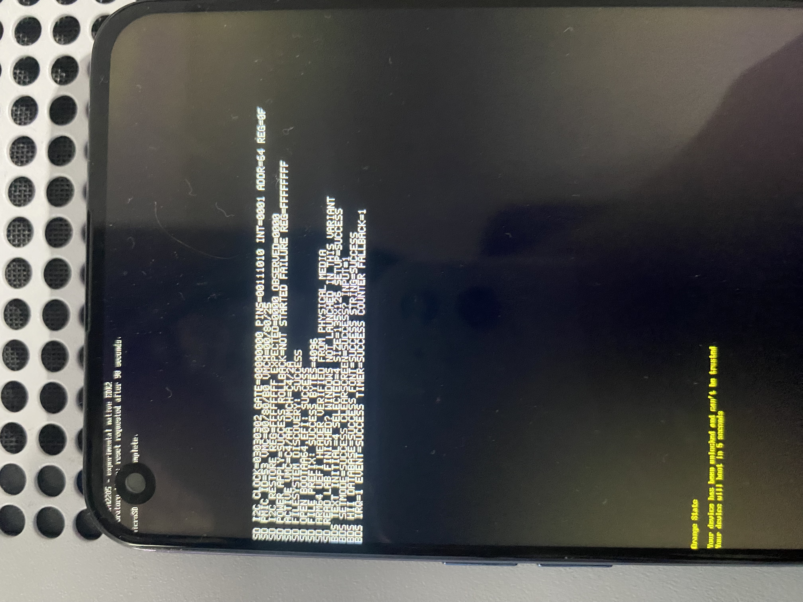

La fotografía del propietario muestra:

```text
SD POWER APPLY=SUCCESS ROLLBACK=NOT STARTED FAILURE REG=FFFFFFFF
SD ACTIVE VMC=C4/AA VMCH=C4/2A
SD FILESYSTEM DISCOVERY: SUCCESS
SD OPEN BOOTAA64.EFI: SUCCESS
SD FILE PREFIX: SUCCESS BYTES=4096
SD ARM64 UEFI HEADER VERIFIED FROM PHYSICAL MEDIA
SD READ LAB FINISHED; WINDOWS NOT LAUNCHED IN THIS VARIANT
```

Los controles `C4` incluyen los bits de habilitación y estado de encendido;
`AA` y `2A` son los selectores de 3,0 V de VMC y VMCH. Son lecturas de registros,
no medidas eléctricas. La restauración I²C no reportó diferencias. La foto
confirma acceso al filesystem y al prefijo del archivo desde el controlador
nativo, lo que implica lecturas de sectores correctas; no muestra el número
total de sectores ni demuestra la lectura completa del ejecutable, su firma o
su ejecución. No se escribió contenido en la tarjeta.

La prueba comenzó al 99 %. El observador detectó Android completo unos 201
segundos después del informe de entrada; ese tiempo incluye LK, Android y
sondeo USB. Después se restauró el recovery original y se verificó de nuevo
Android, con batería al 98 %. La foto conserva sus datos comprimidos y perfil
de color; se retiraron los metadatos personales de cámara. Véase
[la evidencia física filtrada](../evidence/native-sd-power-lab-16-validation.json).

Los contratos se investigaron en el
[controlador I²C de OPPO](https://github.com/oppo-source/android_kernel_oppo_mt6779/blob/0e1e01b9fb281b02d1f50f12ea475d881f3fafd5/drivers/i2c/busses/i2c-mtk.c),
su [mapa de registros](https://github.com/oppo-source/android_kernel_oppo_mt6779/blob/0e1e01b9fb281b02d1f50f12ea475d881f3fafd5/drivers/i2c/busses/i2c-mtk.h)
y la [interfaz MT6360 LDO](https://github.com/oppo-source/android_kernel_oppo_mt6779/blob/0e1e01b9fb281b02d1f50f12ea475d881f3fafd5/drivers/misc/mediatek/pmic/mt6360/ldo/mt6360_ldo_i2c.c).
Se usaron para investigar interfaces; no se incorporó su implementación.
Véase [la validación de PC del intento 12](../evidence/native-sd-read-lab-12-host-validation.json).

## Primer intento de cargar la aplicación EFI (17)

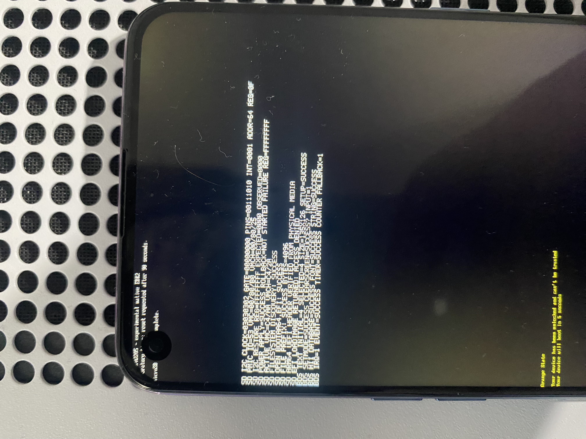

Con los controles de alimentación y arranque activados, la tarjeta volvió a
permitir acceso FAT y lectura del prefijo ARM64. La llamada normal a `LoadImage`
devolvió `Access Denied`. BDS conservó ese error y no llamó a `StartImage`.
Esta prueba no demuestra ejecución de Windows Boot Manager. El observador
detectó Android completo unos 201 segundos después del informe de entrada,
incluyendo LK, Android y sondeo USB. Se restauró el recovery original y se
verificó Android con batería al 98 %, igual que al comienzo. La foto conserva
los datos de imagen comprimidos y el perfil de color, sin metadatos personales.
Véanse [la composición de PC](../evidence/native-sd-boot-lab-17-host-validation.json)
y [la observación física](../evidence/native-sd-boot-lab-17-validation.json).

La inspección de la revisión fijada de
[SecurityStub de EDK2](https://github.com/tianocore/edk2/blob/b03a21a63e3bd001f52c527e5a57feddb53a690b/MdeModulePkg/Universal/SecurityStubDxe/Defer3rdPartyImageLoad.c)
identificó un requisito que faltaba en nuestro BDS: las imágenes externas al
firmware se aplazan con `EFI_ACCESS_DENIED` antes de señalar `EndOfDxe`. Nuestro
código aún no señalaba ese evento. Esto identifica una causa en la composición;
la corrección necesita otra ejecución física para comprobar su efecto.

La variante 18 señala `EndOfDxe` y después `ReadyToBoot`, una vez
conectados los controladores y antes de cargar la aplicación de la tarjeta.
Comprueba creación, señalización y cierre de cada evento. Cualquier error
detiene la carga y libera la ruta del archivo. `LoadImage` continúa por los
servicios y manejadores de seguridad habituales; sus rechazos siguen impidiendo
`StartImage`. Los 23 escenarios de PC comprueban esa secuencia, los seis fallos
de eventos y los rechazos de seguridad, además de los casos anteriores.
La prueba base de BDS mantiene sus 14 escenarios aprobados. La composición ARM64
compiló en unos 27 segundos, con los controles de lectura, encendido y arranque
activados y las fuentes sin cambios durante el build. Son modelos y compilación
de PC, separados de la observación del propietario que sigue. Véase
[la composición del intento 18](../evidence/native-sd-boot-lab-18-host-validation.json).

## Pantalla azul breve y apagado comunicado por el propietario (18)

El propietario informó que vio brevemente una pantalla azul que identificó como
Windows Boot Manager y letras rojas que no pudo capturar. Después aclaró que el
OPPO **se apagó y tuvo que encenderlo con el botón**. No se obtuvo una fotografía,
código de error ni resultado legible de `LoadImage` o `StartImage`. Se registra
como un indicio de ejecución del cargador comunicado por el propietario, sin
convertirlo en una validación completa de Boot Manager, WinPE o el kernel.

El observador ADB detectó Android completo unos 181 segundos después del informe
de entrada. Ese intervalo incluye la intervención manual, LK, Android y sondeo
USB; **no es un retorno automático ni prueba del temporizador de 90 segundos**.
Se restauró el recovery original al volver el propietario y se verificó Android
con batería al 98 %. La siguiente fase debe distinguir una solicitud runtime de
apagado del reset del laboratorio y dar tiempo para leer el diagnóstico. Véase
[la observación filtrada del intento 18](../evidence/native-sd-boot-lab-18-validation.json).

## Captura de la solicitud de apagado (19)

La variante de arranque SD añade un diagnóstico original antes de ejecutar
`ResetSystem`: muestra tipo, estado EFI y la acción solicitada, mantiene la
pantalla 15 segundos y luego conserva la llamada PSCI original. El tipo
`EfiResetShutdown` sigue solicitando apagado; los otros tipos conservan la ruta
de reset existente. No se convierte un apagado en reinicio.

La captura solo se arma si se pudo registrar la notificación de
`ExitBootServices`. Esa notificación la desactiva antes de entrar en runtime,
para evitar accesos posteriores a direcciones físicas de pantalla. Si falla
el registro, se conserva el reset normal sin captura. Durante la pausa se
excluyen interrupciones; el renderizador propio y la espera del contador no
utilizan Boot Services ni asignan memoria. El resto de variantes conserva el
comportamiento anterior.

`OppoBootLogLib` reutiliza los glifos originales de la bitácora mediante una
API separada de uso previo a `ExitBootServices`. Dibuja en la parte inferior,
conservando el centro de una posible pantalla de error del cargador. Los 16
casos de reset de PC verifican tipo PSCI, captura limitada y exclusión después
de `ExitBootServices`; seis casos de memoria protegida comprueban el dibujo y
el rechazo de estado inválido u ocupado. Las pruebas anteriores del logger
en SEC y DXE core también siguen aprobadas. El formateador de estos modelos
está simulado; el firmware usa PrintLib de EDK2. La composición ARM64 compiló
en unos 33 segundos. Se comprobó en AutoGen del controlador runtime que la
captura está activada en esta variante. Véase
[la validación de PC del intento 19](../evidence/native-sd-boot-lab-19-host-validation.json).

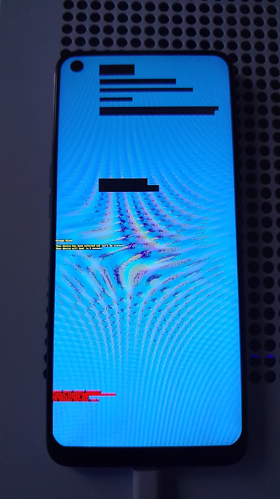

La fotografía muestra una pantalla azul, regiones negras donde se esperaba
texto y el informe original en rojo. Se aceptan como legibles `TYPE=2` y
`REQUEST=POWER OFF`: es una solicitud de apagado por `ResetSystem`, distinta
del reset frío que pide el temporizador de BDS. No se acepta como verificado
el hexadecimal de estado, el título del cargador ni su código de error. La
foto no permite concluir que sea un pantallazo del kernel de Windows.

Por la ruta de ejecución, el archivo EFI previamente inspeccionado y esa
solicitud de apagado, se infiere que llegó a ejecutarse el cargador de la
tarjeta, muy probablemente Windows Boot Manager. La identidad visible y el
error exacto siguen pendientes. Tampoco se ha validado el arranque de WinPE ni
se ha establecido la causa de los defectos gráficos. La duración física de la
pausa no se midió con esta foto.

ADB detectó Android completo unos 131 segundos después del informe de entrada,
con motivo `usb`. No se confirmó el método de encendido en este intento; ese
registro no prueba retorno automático. Se restauró el recovery original y se
verificó Android con batería al 99 %; la prueba comenzó al 98 %. La foto conserva
los datos comprimidos sin metadatos personales. Su orientación de origen era
inválida (`0`); se sustituyó solo esa etiqueta por orientación normal (`1`),
sin girar ni recomprimir píxeles. Véase
[la evidencia física](../evidence/native-sd-boot-lab-19-validation.json).

El propietario pidió detener las pruebas mientras cargaba el teléfono que utiliza
como cámara y después reanudó la sesión. El siguiente paso será obtener el error
legible del cargador y los resultados de carga/entrada antes de atribuir una causa
o afirmar un arranque del sistema operativo.

## Panel ampliado y memoria convencional (20)

El informe previo al reset usa los mismos glifos originales a escala doble,
blancos sobre un panel negro en la parte inferior. La bitácora compartida pasa
a revisión 2 y conserva una copia del avance del cargador en su página de RAM
reservada. La captura runtime solo dibuja esa copia: sigue sin llamar a Boot
Services ni asignar memoria al apagarse.

BDS toma una observación acotada de `GetMemoryMap` antes de `LoadImage` y otra
antes de `StartImage`. Suma únicamente `EfiConventionalMemory`, valida tamaños,
versión y desbordamientos, y libera su buffer. El valor corresponde al instante
con ese pequeño buffer asignado, anterior a entrar en la aplicación; no mide la
memoria restante cuando esta solicita apagarse. Un fallo de observación se
registra como tal y no altera los controles de carga ni seguridad. Esta variante
conserva el pool inicial de 64 MiB.

Campos del panel:

| Campo | Interpretación |
| --- | --- |
| `EFI STATUS` | Estado recibido por `ResetSystem`; no debe confundirse con un código NTSTATUS de Windows |
| `STAGE=1` | Antes de `LoadImage` |
| `STAGE=2` | `LoadImage` retornó; `LOAD` conserva su resultado |
| `STAGE=3` | Se llamó a `StartImage` y todavía no retornó |
| `STAGE=4` | `StartImage` retornó; `RETURN` conserva su resultado |
| `RETURN` en etapa 3 | Valor `EFI_NOT_STARTED` que significa que aún no se registró un retorno |
| `MAP` | Resultado de la última observación del mapa |
| `FREE SNAPSHOT` | MiB enteros de memoria convencional en esa observación; se interpreta únicamente si `MAP` fue correcto |

Las pruebas de PC pasan 33 escenarios SD/EFI, incluidos mapas malformados,
fallos de asignación y suma con desbordamiento. Ocho casos de framebuffer con
memoria protegida comprueban los límites del panel ampliado, el traspaso de
campos y los estados inválidos. Las regresiones SEC y DXE core siguen aprobadas.
Estos modelos no confirman el estado EFI real ni la memoria libre del OPPO.

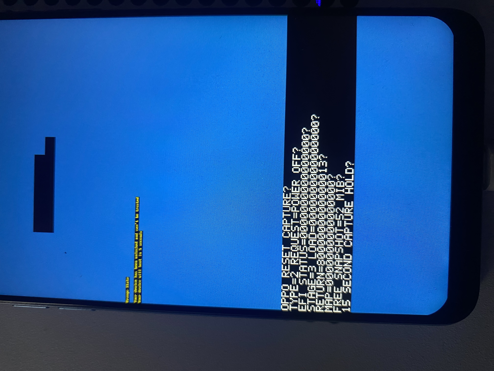

Las fotos de la ejecución física permiten leer `TYPE=2 REQUEST=POWER OFF`,
`EFI STATUS=0000000000000000`, `STAGE=3 LOAD=0000000000000000`,
`RETURN=8000000000000013`, `MAP=0000000000000000` y `FREE SNAPSHOT=52 MIB`.
La carga fue correcta y la aplicación seguía dentro de `StartImage` cuando
solicitó apagado. El valor de `RETURN` es nuestro marcador `EFI_NOT_STARTED`:
todavía no se había registrado un retorno. **No es un error de Windows**.
Tampoco el estado cero de `ResetSystem` revela por qué el cargador se apagó.

Los 52 MiB corresponden a memoria convencional antes de entrar en la aplicación,
no a la memoria libre al apagarse. No prueban ni descartan una asignación fallida
posterior. Este intento no confirma `EFI_OUT_OF_RESOURCES`, un código NTSTATUS,
WinPE ni ejecución del kernel. La identidad de Boot Manager sigue sustentada
por la inspección del archivo y la ruta de ejecución, no por un título legible.

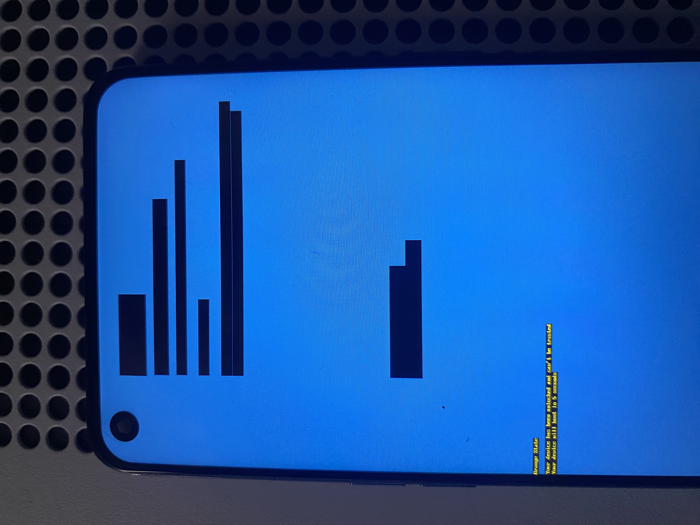

El siguiente diagnóstico se centrará en el texto oculto por rectángulos negros.
Los signos `?` al final de las líneas del panel son un defecto del renderizador
propio al recibir retornos de carro del formateador, separados de la pantalla
azul del cargador. ADB detectó Android completo unos 134 segundos después del
informe de entrada, con motivo `usb`; no se confirmó el método de encendido,
por lo que no se afirma retorno automático. Se restauró el recovery original
y se verificó Android con batería al 100 %. Las dos fotografías conservan sus
píxeles comprimidos, orientación y perfil de color, sin metadatos personales.
Véanse [la compilación y pruebas de PC](../evidence/native-sd-boot-lab-20-host-validation.json),
[la evidencia física filtrada](../evidence/native-sd-boot-lab-20-validation.json)
y [la revisión de las fotos](../evidence/native-sd-boot-lab-20-photos.json).

## Diagnóstico de opacidad (21)

La captura previa al apagado ajusta a `0xff` el byte superior de cada píxel
visible, conservando todos los bits RGB y el relleno de las filas. Solo se
ejecuta cuando `StartImage` sigue activo y la captura anterior a
`ExitBootServices` está armada. No cambia el modo GOP, registros del controlador
de pantalla, política de carga ni la solicitud PSCI de apagado. Después muestra
`ALPHA FIX`, número de píxeles ajustados, y `COLOR`, cuántos de ellos contenían
RGB distinto de cero. Son recuentos diagnósticos, no confirmación de la causa.

La hipótesis es que el byte reservado que escribe la aplicación pueda estar
siendo interpretado como opacidad por la pantalla heredada. Si los glifos RGB
ya existen en el framebuffer, este diagnóstico podría volverlos visibles al
final. No se añade una reparación permanente durante la ejecución del cargador
ni se afirma compatibilidad gráfica completa. También se omiten los retornos
de carro que introducía el formateador en las líneas del panel propio.

Once casos con memoria protegida en PC verifican que el ajuste no modifica RGB,
padding ni estado inválido/ocupado, es idempotente y conserva los píxeles ya
opacos. Se comprueban también la traza ausente y CRLF; el formateador sigue
simulado. Las regresiones SEC y DXE core pasan con sanitizadores. La variante
ARM64 compiló en unos 29 segundos;
véase [la evidencia de PC](../evidence/native-sd-boot-lab-21-host-validation.json).

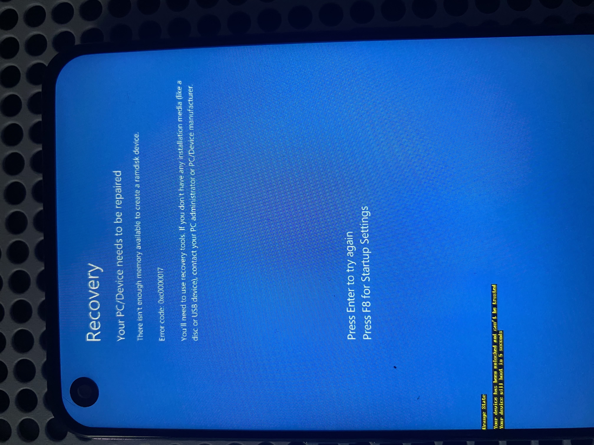

La fotografía física permite leer `Recovery`, el mensaje de memoria insuficiente
para crear un dispositivo ramdisk y **`Error code: 0xc0000017`**. Con la ruta EFI
de la tarjeta y la inspección previa de `bootmgr.exe`, se confirma la pantalla de
recuperación de Windows Boot Manager. No es un pantallazo del kernel ni prueba
de arranque de WinPE. No se ha medido el tamaño o requisito de contigüidad de la
asignación que falló; EDK2 conserva el pool de 64 MiB, no los 6 GiB físicos.

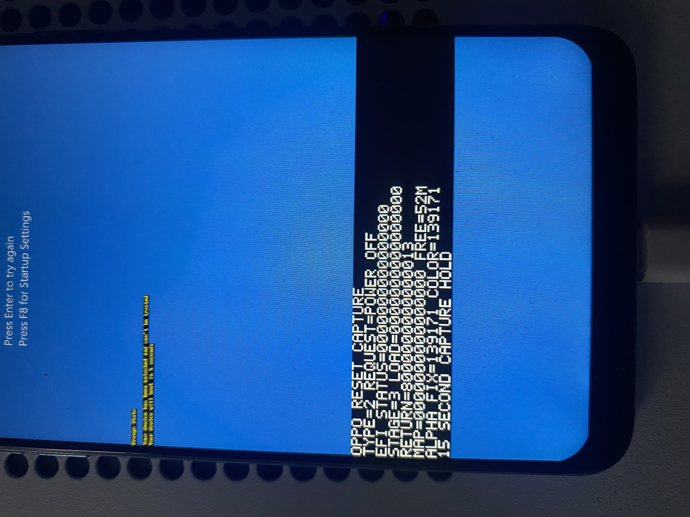

El panel muestra `ALPHA FIX=139171 COLOR=139171`. Esos píxeles tenían color RGB
pero no opacidad completa; al modificar solo el byte superior, el texto antes
oculto se hizo legible. Esto demuestra un problema de opacidad en esa captura,
sin validar todavía una solución permanente para GOP o el controlador físico.
Se mantienen `TYPE=2 REQUEST=POWER OFF`, estado EFI cero, etapa 3, carga correcta,
marcador de retorno `EFI_NOT_STARTED`, mapa correcto y observación previa de
52 MiB. El estado de apagado no es el código de error de Windows.

ADB detectó Android completo unos 132 segundos después del informe de entrada,
con motivo `usb`. El método de encendido no se confirmó por separado; no se
afirma retorno automático. Se restauró el recovery original y se verificó
Android al 100 % de batería. Las fotografías conservan los píxeles comprimidos,
orientación y perfil de color, sin metadatos personales. Véanse
[la evidencia física](../evidence/native-sd-boot-lab-21-validation.json) y
[la revisión de las fotografías](../evidence/native-sd-boot-lab-21-photos.json).

## Aplicación EFI de la tarjeta

Una copia privada leída mediante ADB `exec-out` mide 1 538 888 bytes. Su cabecera
indica ARM64 y aplicación UEFI; su recurso de versión la identifica como
**Boot Manager**, `bootmgr.exe`, versión `10.0.19041.662`, de Microsoft. El recurso
no equivale a verificar una firma digital. La imagen declara unos 1,73 MiB en
memoria y una reserva de pila de 1 MiB; esos números no son un requisito total
de RAM para Windows PE. Véase [la inspección](../evidence/sd-windows-loader-inspection.json).
No se publica la copia del ejecutable ni contenido de la tarjeta.

La ruta experimental de BDS ya separa `LoadImage` y `StartImage` con la ruta de
esa microSD y conserva el resultado exacto de cada servicio. Está desactivada
por defecto y no se ejecutó en las pruebas físicas de lectura. Solo considera
el dispositivo SD de este controlador, después de leer una cabecera ARM64 UEFI.
Los archivos se cierran antes de cargar; el cargador recibe la identidad del
filesystem SD, en vez de una copia del ejecutable en memoria. Un rechazo de
seguridad no llega a `StartImage`. Una aplicación que retorna no se descarga dos veces.

La ruta pasó 16 escenarios de PC, incluyendo otros discos excluidos, cabeceras
inválidas, fallos de carga, rechazo de seguridad, falta de memoria para la ruta y
retorno de la aplicación. Compiló para ARM64 en `sd-boot-lab` con ambos PCD
activados, mientras el FD del intento físico 14 tiene el PCD de boot en falso.
Esto es validación de PC; el resultado posterior comunicado por el propietario
en el intento 18 se documenta por separado arriba.
Véase [la evidencia de compilación del cargador](../evidence/native-sd-boot-host-validation.json).
La [especificación UEFI](https://uefi.org/specs/UEFI/2.11/07_Services_Boot_Services.html#image-services)
define esas operaciones y la carga desde un filesystem. Los
[requisitos de Windows sobre SoC](https://learn.microsoft.com/en-us/windows-hardware/drivers/bringup/uefi-requirements-that-apply-to-all-windows-platforms)
incluyen servicios de firmware y tablas de plataforma que aún no se han
validado aquí. Ver una pantalla del cargador no demostraría que WinPE o su
kernel puedan completar el arranque.

Durante la inspección se detectó que `adb shell -T` alteraba los bytes LF del
archivo en este equipo. La cabecera inválida fue rechazada; `exec-out` conservó
el PE válido. Los métodos de captura binaria ahora utilizan esa vía, con pruebas
de bytes NUL/CR/LF y el mismo mínimo de batería. Los diagnósticos nativos MSDC
no utilizan ADB para leer la tarjeta.

Para compilar esta variante, se añade `NATIVE_SD_READ_LAB=1` al entorno de
`scripts/build_native_firmware.sh`. Su salida se separa en
`.build/native/sd-read-lab/`; no sustituye el FD anterior de Shell. El script
solo compila. Las imágenes y los informes con identificadores permanecen privados.

La variante `sd-read-lab` muestra resultados y solicita reset a los 90 segundos,
sin lanzar Shell ni Windows. `NATIVE_SD_BOOT_LAB=1` selecciona el modo separado
`sd-boot-lab` e incluye las capas SD. Para conservar el encendido comprobado en
el intento 16 también se requiere `NATIVE_SD_POWER_LAB=1`; ambos controles están
desactivados por defecto. No debe confundirse la compilación con una prueba
física del cargador. La ruta y el plazo exactos del retorno siguen sin
medir. La batería mínima sigue siendo 20 % antes de cada fase física.
