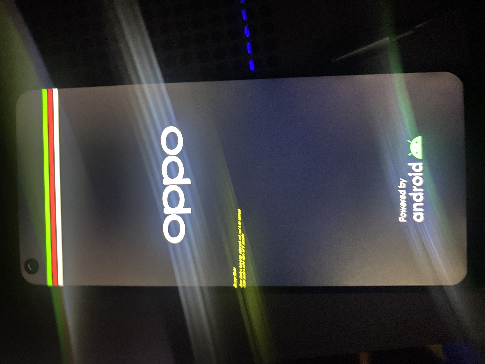
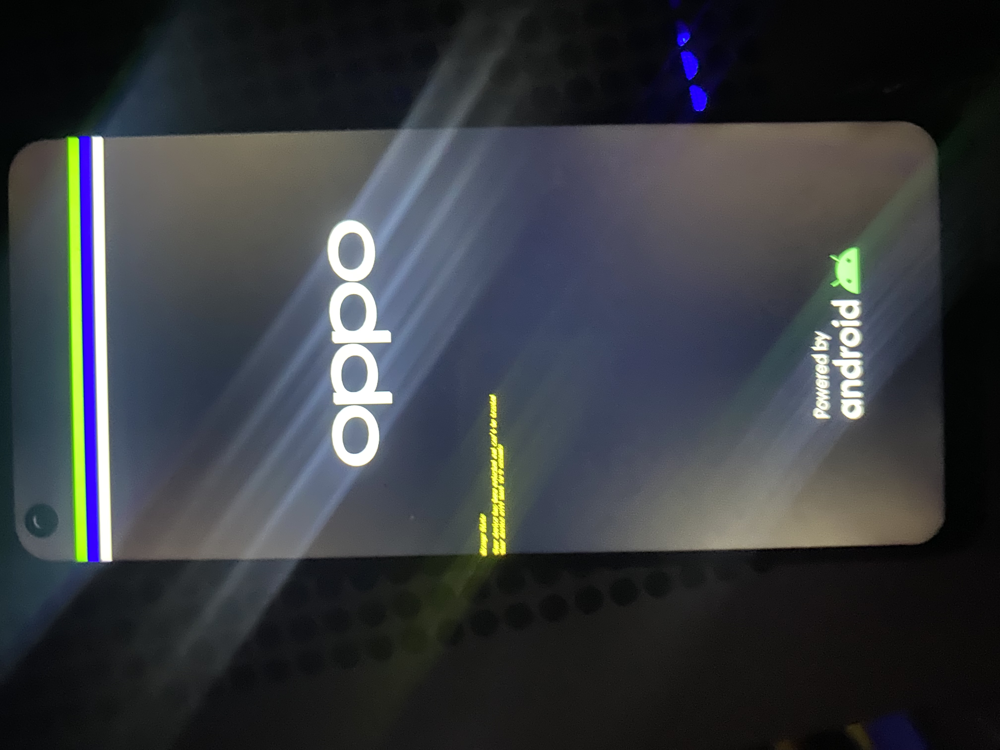

# Prototipo de firmware nativo

`OppoNative.dsc` y `OppoNative.fdf` componen un prototipo para compilar e
inspeccionar en PC. No son instrucciones de instalación. Una variante corta
ya mostró su franja verde en el OPPO y volvió a Android; todavía no se observó
la ejecución física del prototipo integrado con DXE y Shell. Una segunda
variante corta ya superó HOBs, cambio de pila y activación de MMU/cachés.

La imagen tiene 8 MiB y comienza en `0x40080000`. Su cabecera ARM64 salta
directamente al volumen FV situado en `0x40081000`; el vector de ese volumen
entra en la SEC propia. No hay BootShim, un cargador de otro port, una copia
del firmware a otra dirección ni un payload concatenado.

## Implementación propia

- **SEC:** conserva el FDT, comprueba la plataforma y el estado de entrada,
  contrasta direcciones de GIC y watchdog con el árbol recibido, interpreta las
  reservas y propone el pool inicial. Construye HOBs y un mapa de identidad
  acotado, habilita MMU/cachés y llama al cargador del núcleo DXE de EDK2.
- **GOP:** consume exclusivamente el HOB propio con geometría validada y ofrece
  un modo, consultas y las cuatro operaciones BLT mediante la biblioteca
  original de framebuffer. No inicializa el panel ni cambia sus relojes.
- **Servicios iniciales:** proporciona solicitudes de reinicio y apagado PSCI.
  Las operaciones RTC devuelven expresamente `EFI_UNSUPPORTED`.
- **BDS de laboratorio:** conecta controladores, selecciona la consola gráfica
  y busca la Shell dentro del FV. Solicita un reinicio mediante un evento de
  90 segundos para las primeras pruebas.

Los núcleos DXE y runtime, las primitivas ARM, GIC, temporizador, HII, consola,
variables en RAM y la Shell proceden de la dependencia base EDK2. No se importó
código de otro port ni de controladores específicos ajenos. Véase [ORIGIN.md](ORIGIN.md).

## Límites del perfil

El pool inicial de 64 MiB empieza en `0x43000000`. Es una propuesta contrastada
con la captura Linux existente; no representa toda la RAM disponible para un
OS. Las reservas estáticas se protegen con los tipos de memoria correspondientes;
las solicitudes dinámicas quedan diferidas al OS. La dirección real del FDT se
valida y protege al recibir el control.

El perfil de pantalla usa la base del tag nativo de LK y la geometría observada
por el diagnóstico Linux: 1080 × 2400 y stride 4352. Su continuidad antes de
Linux se observó durante la prueba corta de SEC. Las barras de
etapa nativas se sitúan desde la fila 160; la barra de la fotografía anterior
pertenece al diagnóstico Linux y no demuestra ejecución de este firmware.

El modo del watchdog se trata con la clave `0x22000000` y el bit de habilitación
documentados en el
[kernel OPPO inspeccionado](https://github.com/oppo-source/android_kernel_oppo_mt6779/blob/0e1e01b9fb281b02d1f50f12ea475d881f3fafd5/drivers/watchdog/mtk_wdt.c).
La implementación es propia. La franja verde de la prueba corta sucede después
de comprobar PSCI_VERSION y de deshabilitar el watchdog con lectura posterior.
Todavía faltan medidas del estado de entrada y pruebas de GIC y temporizadores.

El temporizador BDS depende de que funcionen esas piezas. No garantiza que una
excepción temprana o un bloqueo vuelva a Android; el reset tampoco demuestra
que LK abandone el modo recovery. Antes de una instalación física se necesita
una estrategia de prueba y restauración independiente de ese temporizador.

No hay controladores de almacenamiento, teclado, botones ni USB nativo, ni
persistencia de variables, ACPI o arranque de Windows. La consola de entrada
genérica puede existir sin un dispositivo de entrada conectado. Este prototipo
no integra una opción en el menú Fastbootd; se avisará al propietario antes de
empezar esa fase para que pueda cambiar a Astra.

## Comprobaciones

La compilación y la inspección del contenedor son pasos distintos de ejecutar
el firmware. El registro público de resultados debe indicar cada uno por
separado. El inspector comprueba la cabecera ARM64, límites y checksums FV/FFS,
módulos AArch64 requeridos y la correspondencia entre el salto del FV y la
entrada TE de la SEC.

La prueba del GOP enlaza el controlador real con servicios UEFI simulados y
RAM sintética. Comprueba el rechazo de HOBs incorrectos, geometría, padding,
consultas de modo y las cuatro operaciones BLT con ASan/UBSan. No accede a la
pantalla física. Las pruebas QEMU de la entrada SEC usan una rutina C de prueba;
no ejecutan este núcleo DXE ni su Shell.

Los comandos se encuentran en [BUILD.md](BUILD.md). El script de compilación
no empaqueta un recovery ni utiliza ADB, Fastboot o herramientas MediaTek.

## Prueba corta de entrada

`NATIVE_ENTRY_PROBE=1` construye una variante de SEC que, tras validar el
handoff y la propuesta de memoria, intenta dibujar dos franjas y solicita
`PSCI_SYSTEM_RESET` después de diez segundos. Termina antes de construir HOBs,
habilitar la MMU o entrar en DXE. La variante normal no contiene su marcador;
el empaquetador rechaza un FD normal como candidato para esta fase.

La primera instalación de esa variante **no llegó a la entrada nativa**. Se
había puesto el FD sin comprimir en el campo kernel del contenedor Android.
El registro privado de LK indicó `gzip header is not correct` y
`decompress kernel image fail`, con tamaño `0x00800000`. El propietario observó
pantalla negra y reinicios hasta Android. No se atribuye ese retorno a PSCI.
Se restauró el recovery original y una lectura completa de sus 64 MiB confirmó
que coincide con el respaldo.

El empaquetador corregido transporta el FD mediante un único miembro gzip.
La descompresión que hace LK debe producir la misma cabecera ARM64 y entrada
directa; no se añade un cargador. La validación en PC limita la salida a 8 MiB,
comprueba integridad, rechaza miembros adicionales y conserva DTB, DTBO,
second y los demás campos del recovery original salvo tamaños, ID y offset.
El ramdisk nuevo es un archivo vacío, sin servicios OEM. Se conservan las
propiedades AVB usando algoritmo `NONE`; esto no constituye una firma OEM.

Los candidatos, respaldos, registros originales e identificadores permanecen
fuera del repositorio público. Una prueba posterior debe registrar por separado
la aceptación del contenedor por LK, la ejecución de SEC y la salida a Android.

En el segundo intento, con gzip y el mismo FD, el propietario vio la franja
verde y el reinicio automático a Android. ADB confirmó el arranque completo,
batería al 80 % y motivo `reboot`, en lugar del `lk_crash` anterior. No se vio la
franja blanca ni se midió el intervalo: el retorno es compatible con la solicitud
PSCI del probe, pero no se atribuye de forma concluyente a esa ruta. La franja
verde confirma que SEC llegó a validar handoff, PSCI_VERSION, watchdog, reservas,
plan inicial y framebuffer. Esta variante termina antes de HOBs, MMU y DXE.

La variante siguiente, `NATIVE_MMU_PROBE=1`, conserva un marcador distinto y
desplaza la parada hasta después de crear HOBs, cambiar a la pila del pool y
configurar el mapa MMU. Antes de mostrar azul comprueba los bits M, C e I de
SCTLR; luego intenta mostrar blanco, espera con el contador físico y solicita
reset. Sigue sin entrar en DXE. La herramienta exige que la fase declarada en
el manifiesto coincida con el marcador de SEC y rechaza mezclas de variantes.
En su primera prueba física el propietario observó tres franjas, de arriba
abajo verde, roja y blanca, y retorno automático a Android. ADB confirmó el
arranque completo, batería al 81 % y motivo `reboot`. La franja intermedia se
escribe después de comprobar M/C/I; la blanca pertenece a la espera anterior
al reset. No se entró en DXE ni Shell. El rojo donde se esperaba azul sugiere
que el orden de canales antes de Linux difiere de la captura Linux: ese perfil
de color requiere otra comprobación. No se midió el intervalo ni se atribuye
concluyentemente el retorno a una ruta PSCI concreta.

Fotografía del propietario, publicada a petición suya. Las tres franjas
corresponden a la prueba corta de MMU; el logo OPPO y el aviso Orange State
permanecen de LK. Esta imagen no muestra DXE ni la Shell. Se retiraron los
metadatos de cámara y se conservaron orientación, perfil de color y datos
comprimidos de la imagen sin recomprimirlos. Véase
[el registro de revisión de la foto](../evidence/native-mmu-photo.json).

## Laboratorio DXE/Shell

El siguiente candidato utiliza la variante integrada, sin los marcadores de
parada de SEC. `prepare_native_lab.py` exige el identificador propio del BDS
de laboratorio y conserva el mismo transporte gzip y ramdisk vacío. La
herramienta de sesión requiere `--execute-native-firmware-lab`, separado de
los modos de prueba corta, Linux y restauración.

El candidato usa rojo=16/azul=0 a partir de la franja azul observada roja en el
probe anterior. El contraste de las dos fotografías confirmó el orden nativo
en esas franjas, sin modificar lo que se midió después bajo Linux. GOP también
se comprobó en PC con ambos órdenes.

Al entrar en BDS se intenta dibujar una cuarta franja amarilla mediante GOP,
antes de conectar la consola. Si la consola funciona, se limpia la pantalla y
se imprime el encabezado de laboratorio antes de cargar la Shell. Una franja
amarilla sin texto permitiría localizar el avance hasta BDS; las tres franjas
de SEC por sí solas no demuestran DXE. El timer de 90 segundos sigue siendo
una solicitud de reset sin garantía frente a errores o interrupciones ausentes.

En el primer intento integrado se observaron únicamente las franjas verde,
azul y blanca. La fotografía confirma el orden de color corregido. La última
etapa confirmada es SEC, después del HOB de información de arranque y antes de
llamar a `LoadDxeCoreFromFv`. Sin la marca amarilla ni texto no se puede
distinguir todavía entre un bloqueo en la carga y uno dentro de DXE o sus
controladores. No se verificó ejecución de BDS ni de la Shell.

Después de 142 segundos no había reinicio automático ni ADB. El propietario
reinició con los botones; Android completó el arranque, con batería al 81 %.
El temporizador de BDS no se considera validado. Se restauró el recovery
original y se volvió a comprobar Android antes de preparar otro diagnóstico.

Fotografía del propietario publicada a petición suya; muestra el resultado
detenido, no una Shell funcional. El logo y Orange State siguen siendo de LK.
Se conservaron los datos comprimidos de imagen, orientación y perfil de color,
retirando los demás metadatos de cámara. El registro está en
[native-dxe-shell-lab-photo.json](../evidence/native-dxe-shell-lab-photo.json).

## Diagnóstico de texto propio

El siguiente diagnóstico añade `OppoDebugLib` a SEC y al núcleo DXE, usando
la interfaz DebugLib de la dependencia base EDK2. El renderer y sus glifos 5×7
son originales. La biblioteca usa el framebuffer ya validado y escribe desde
la fila 320, conservando las barras de etapa. No instala consola UEFI ni
controladores de entrada.

Una página del pool, `0x46fef000`, conserva el cursor entre SEC y DXE. Se sitúa
justo debajo de la pila y se excluye del área libre del constructor de HOBs,
con una asignación `EfiBootServicesData`. SEC inicia la página después de
validar handoff, pool y framebuffer. La variante del núcleo comprueba firma
y geometría desde su primera llamada, incluso en las comprobaciones de memoria
anteriores a sus constructores. El constructor vuelve a enlazar el mismo
cursor. En SEC las llamadas anteriores a su inicialización permanecen
desactivadas. Un indicador descarta llamadas
anidadas; los asserts muestran el nombre base del archivo y detienen la CPU.

La prueba de PC utiliza el código real y mapeos virtuales sintéticos con páginas
de guarda. Comprueba el área superior intacta, padding por fila, salto y vuelta
de líneas, truncado, rechazo de estado inválido, continuidad del cursor y parada
por assert, con ASan/UBSan. El formato de cadenas se simula en esa prueba;
el firmware enlaza el PrintLib genérico de EDK2. Estos resultados no prueban
todavía que los mensajes sean visibles en el teléfono.

La compilación ARM64 de este diagnóstico finalizó correctamente y el inspector
validó el FD y su marcador integrado. Se comprobó que la variante del núcleo
se construyera con su enlace temprano y que las fuentes conservaran los hashes
tomados antes del build. La ejecución observada en PC tardó 34,345 segundos,
con caché Linux respaldada en G: y presupuesto de ocho módulos por cuatro
objetos. No se midió el pico de CPU y no es un benchmark controlado frente al
build anterior. Véase [la validación de PC](../evidence/native-display-log-host-validation.json).
