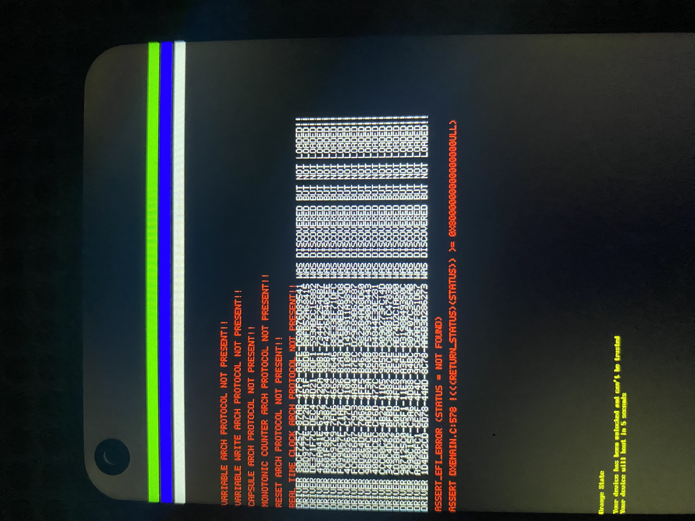
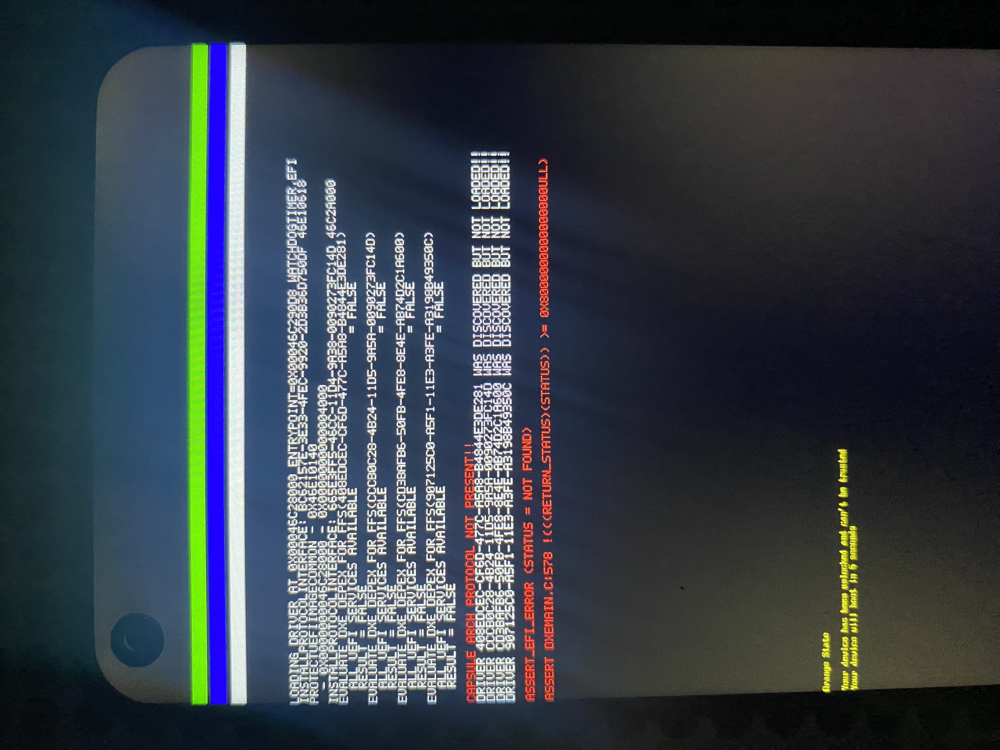
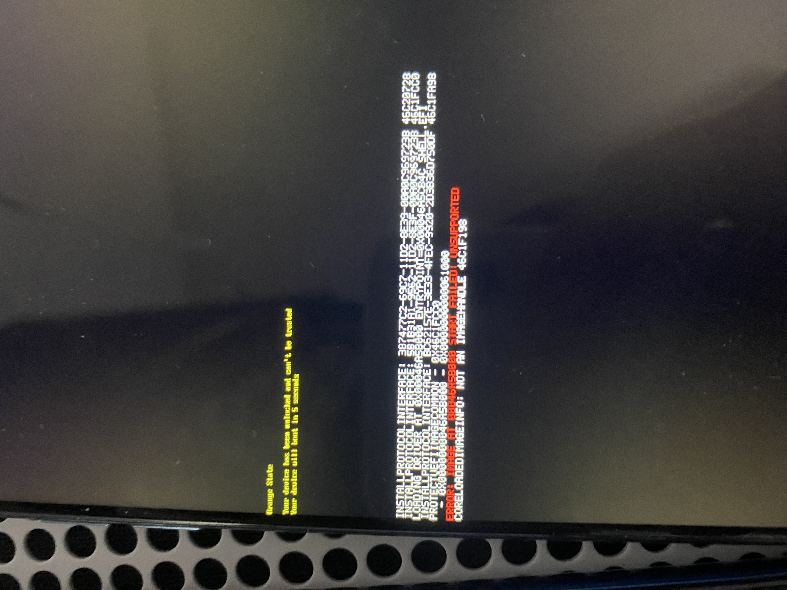
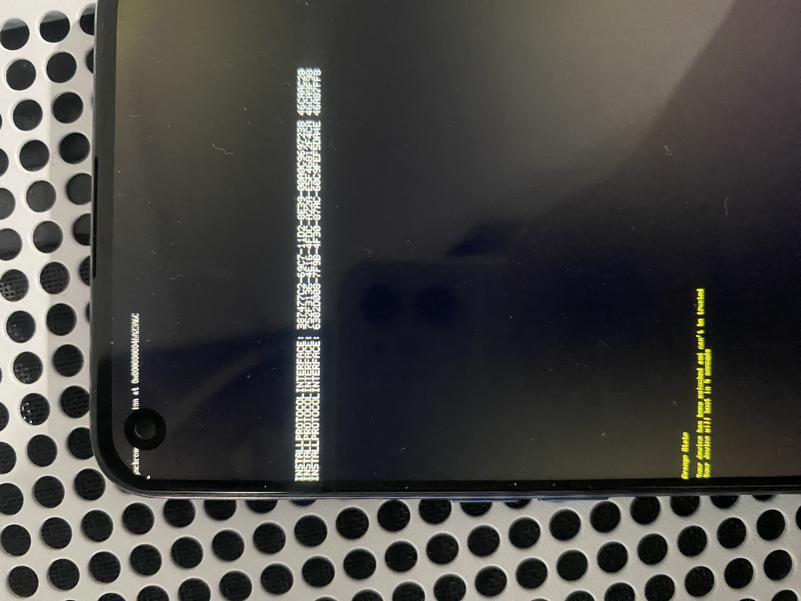
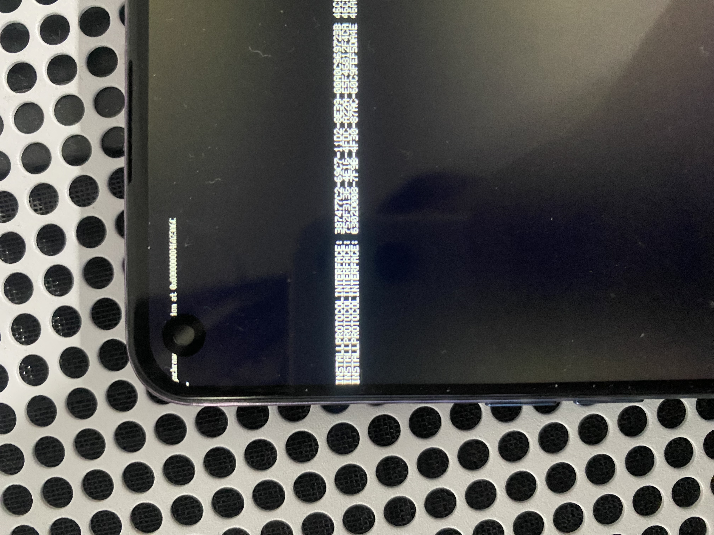
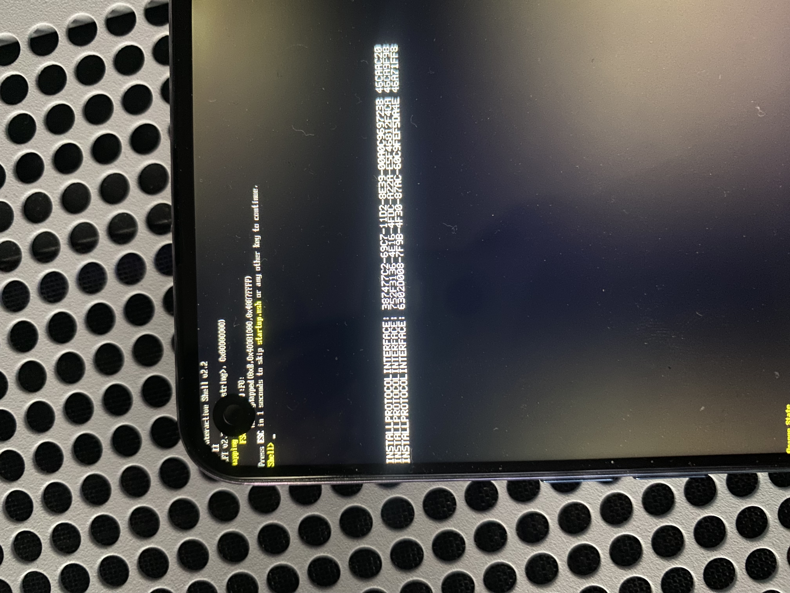

# Prototipo de firmware nativo

`OppoNative.dsc` y `OppoNative.fdf` componen un prototipo para compilar e
inspeccionar en PC. No son instrucciones de instalación. Una variante corta
ya mostró su franja verde en el OPPO y volvió a Android. Una segunda variante
corta superó HOBs, cambio de pila y activación de MMU/cachés. Los intentos
integrados posteriores sí ejecutaron el núcleo DXE y el registro de texto
propio. Tras resolver composición PCD, consola e inicialización de parámetros,
el séptimo intento mostró UEFI Interactive Shell v2.2 y el prompt `Shell>`.
Volvió automáticamente a Android y se restauró recovery original. La entrada
de usuario y ejecución de comandos siguen pendientes.
Las etapas, sus límites y las fotos se detallan abajo.

La [preparación ACPI](ACPI.md) contiene un generador original validado en PC.
Todavía no forma parte del FD nativo ni se ha instalado en el OPPO; no cambia
el resultado físico de Windows o la Shell descrito aquí.

La imagen tiene 8 MiB y comienza en `0x40080000`. Su cabecera ARM64 salta
directamente al volumen FV situado en `0x40081000`; el vector de ese volumen
entra en la SEC propia. No hay BootShim, un cargador de otro port, una copia
del firmware a otra dirección ni un payload concatenado.

## Implementación propia

- **SEC:** conserva el FDT, comprueba la plataforma y el estado de entrada,
  contrasta direcciones de GIC y watchdog con el árbol recibido, interpreta las
  reservas y propone el pool inicial. Construye HOBs y un mapa de identidad
  acotado, habilita MMU/cachés y llama al cargador del núcleo DXE de EDK2.
- **GOP:** consume exclusivamente el HOB propio con geometría validada y ofrece
  un modo, consultas y las cuatro operaciones BLT mediante la biblioteca
  original de framebuffer. No inicializa el panel ni cambia sus relojes.
- **Servicios iniciales:** proporciona solicitudes de reinicio y apagado PSCI.
  Las operaciones RTC y Capsule devuelven expresamente `EFI_UNSUPPORTED`;
  la ruta física ya superó la comprobación de protocolos arquitectónicos y
  alcanzó BDS, aunque no se midió el CRC de la tabla runtime.
- **BDS de laboratorio:** conecta controladores, selecciona la consola gráfica
  y busca la Shell dentro del FV. Solicita un reinicio mediante un evento de
  90 segundos para las primeras pruebas.

Los núcleos DXE y runtime, las primitivas ARM, GIC, temporizador, HII, consola,
variables en RAM y la Shell proceden de la dependencia base EDK2. No se importó
código de otro port ni de controladores específicos ajenos. Véase [ORIGIN.md](ORIGIN.md).

## Límites del perfil

El pool inicial de 64 MiB empieza en `0x43000000`. Es una propuesta contrastada
con la captura Linux existente; no representa toda la RAM disponible para un
OS. Las reservas estáticas se protegen con los tipos de memoria correspondientes;
las solicitudes dinámicas quedan diferidas al OS. La dirección real del FDT se
valida y protege al recibir el control.

El perfil de pantalla usa la base del tag nativo de LK y la geometría observada
por el diagnóstico Linux: 1080 × 2400 y stride 4352. Su continuidad antes de
Linux se observó durante la prueba corta de SEC. Las barras de
etapa nativas se sitúan desde la fila 160; la barra de la fotografía anterior
pertenece al diagnóstico Linux y no demuestra ejecución de este firmware.

El modo del watchdog se trata con la clave `0x22000000` y el bit de habilitación
documentados en el
[kernel OPPO inspeccionado](https://github.com/oppo-source/android_kernel_oppo_mt6779/blob/0e1e01b9fb281b02d1f50f12ea475d881f3fafd5/drivers/watchdog/mtk_wdt.c).
La implementación es propia. La franja verde de la prueba corta sucede después
de comprobar PSCI_VERSION y de deshabilitar el watchdog con lectura posterior.
Todavía faltan medidas del estado de entrada y pruebas de GIC y temporizadores.

El temporizador BDS depende de que funcionen esas piezas. No garantiza que una
excepción temprana o un bloqueo vuelva a Android; el reset tampoco demuestra
que LK abandone el modo recovery. Antes de una instalación física se necesita
una estrategia de prueba y restauración independiente de ese temporizador.

No hay controladores de almacenamiento, teclado, botones ni USB nativo, ni
persistencia de variables, ACPI o arranque de Windows. La consola de entrada
genérica puede existir sin un dispositivo de entrada conectado. Este prototipo
no integra una opción en el menú Fastbootd; se avisará al propietario antes de
empezar esa fase para que pueda cambiar a Astra.

## Comprobaciones

La compilación y la inspección del contenedor son pasos distintos de ejecutar
el firmware. El registro público de resultados debe indicar cada uno por
separado. El inspector comprueba la cabecera ARM64, límites y checksums FV/FFS,
módulos AArch64 requeridos y la correspondencia entre el salto del FV y la
entrada TE de la SEC.

La prueba del GOP enlaza el controlador real con servicios UEFI simulados y
RAM sintética. Comprueba el rechazo de HOBs incorrectos, geometría, padding,
consultas de modo y las cuatro operaciones BLT con ASan/UBSan. No accede a la
pantalla física. Las pruebas QEMU de la entrada SEC usan una rutina C de prueba;
no ejecutan este núcleo DXE ni su Shell.

Los comandos se encuentran en [BUILD.md](BUILD.md). El script de compilación
no empaqueta un recovery ni utiliza ADB, Fastboot o herramientas MediaTek.

## Prueba corta de entrada

`NATIVE_ENTRY_PROBE=1` construye una variante de SEC que, tras validar el
handoff y la propuesta de memoria, intenta dibujar dos franjas y solicita
`PSCI_SYSTEM_RESET` después de diez segundos. Termina antes de construir HOBs,
habilitar la MMU o entrar en DXE. La variante normal no contiene su marcador;
el empaquetador rechaza un FD normal como candidato para esta fase.

La primera instalación de esa variante **no llegó a la entrada nativa**. Se
había puesto el FD sin comprimir en el campo kernel del contenedor Android.
El registro privado de LK indicó `gzip header is not correct` y
`decompress kernel image fail`, con tamaño `0x00800000`. El propietario observó
pantalla negra y reinicios hasta Android. No se atribuye ese retorno a PSCI.
Se restauró el recovery original y una lectura completa de sus 64 MiB confirmó
que coincide con el respaldo.

El empaquetador corregido transporta el FD mediante un único miembro gzip.
La descompresión que hace LK debe producir la misma cabecera ARM64 y entrada
directa; no se añade un cargador. La validación en PC limita la salida a 8 MiB,
comprueba integridad, rechaza miembros adicionales y conserva DTB, DTBO,
second y los demás campos del recovery original salvo tamaños, ID y offset.
El ramdisk nuevo es un archivo vacío, sin servicios OEM. Se conservan las
propiedades AVB usando algoritmo `NONE`; esto no constituye una firma OEM.

Los candidatos, respaldos, registros originales e identificadores permanecen
fuera del repositorio público. Una prueba posterior debe registrar por separado
la aceptación del contenedor por LK, la ejecución de SEC y la salida a Android.

En el segundo intento, con gzip y el mismo FD, el propietario vio la franja
verde y el reinicio automático a Android. ADB confirmó el arranque completo,
batería al 80 % y motivo `reboot`, en lugar del `lk_crash` anterior. No se vio la
franja blanca ni se midió el intervalo: el retorno es compatible con la solicitud
PSCI del probe, pero no se atribuye de forma concluyente a esa ruta. La franja
verde confirma que SEC llegó a validar handoff, PSCI_VERSION, watchdog, reservas,
plan inicial y framebuffer. Esta variante termina antes de HOBs, MMU y DXE.

La variante siguiente, `NATIVE_MMU_PROBE=1`, conserva un marcador distinto y
desplaza la parada hasta después de crear HOBs, cambiar a la pila del pool y
configurar el mapa MMU. Antes de mostrar azul comprueba los bits M, C e I de
SCTLR; luego intenta mostrar blanco, espera con el contador físico y solicita
reset. Sigue sin entrar en DXE. La herramienta exige que la fase declarada en
el manifiesto coincida con el marcador de SEC y rechaza mezclas de variantes.
En su primera prueba física el propietario observó tres franjas, de arriba
abajo verde, roja y blanca, y retorno automático a Android. ADB confirmó el
arranque completo, batería al 81 % y motivo `reboot`. La franja intermedia se
escribe después de comprobar M/C/I; la blanca pertenece a la espera anterior
al reset. No se entró en DXE ni Shell. El rojo donde se esperaba azul sugiere
que el orden de canales antes de Linux difiere de la captura Linux: ese perfil
de color requiere otra comprobación. No se midió el intervalo ni se atribuye
concluyentemente el retorno a una ruta PSCI concreta.

Fotografía del propietario, publicada a petición suya. Las tres franjas
corresponden a la prueba corta de MMU; el logo OPPO y el aviso Orange State
permanecen de LK. Esta imagen no muestra DXE ni la Shell. Se retiraron los
metadatos de cámara y se conservaron orientación, perfil de color y datos
comprimidos de la imagen sin recomprimirlos. Véase
[el registro de revisión de la foto](../evidence/native-mmu-photo.json).

## Laboratorio DXE/Shell

El siguiente candidato utiliza la variante integrada, sin los marcadores de
parada de SEC. `prepare_native_lab.py` exige el identificador propio del BDS
de laboratorio y conserva el mismo transporte gzip y ramdisk vacío. La
herramienta de sesión requiere `--execute-native-firmware-lab`, separado de
los modos de prueba corta, Linux y restauración.

El candidato usa rojo=16/azul=0 a partir de la franja azul observada roja en el
probe anterior. El contraste de las dos fotografías confirmó el orden nativo
en esas franjas, sin modificar lo que se midió después bajo Linux. GOP también
se comprobó en PC con ambos órdenes.

Al entrar en BDS se intenta dibujar una cuarta franja amarilla mediante GOP,
antes de conectar la consola. Si la consola funciona, se limpia la pantalla y
se imprime el encabezado de laboratorio antes de cargar la Shell. Una franja
amarilla sin texto permitiría localizar el avance hasta BDS; las tres franjas
de SEC por sí solas no demuestran DXE. El timer de 90 segundos sigue siendo
una solicitud de reset sin garantía frente a errores o interrupciones ausentes.

En el primer intento integrado se observaron únicamente las franjas verde,
azul y blanca. La fotografía confirma el orden de color corregido. La última
etapa confirmada es SEC, después del HOB de información de arranque y antes de
llamar a `LoadDxeCoreFromFv`. Sin la marca amarilla ni texto no se puede
distinguir todavía entre un bloqueo en la carga y uno dentro de DXE o sus
controladores. No se verificó ejecución de BDS ni de la Shell.

Después de 142 segundos no había reinicio automático ni ADB. El propietario
reinició con los botones; Android completó el arranque, con batería al 81 %.
El temporizador de BDS no se considera validado. Se restauró el recovery
original y se volvió a comprobar Android antes de preparar otro diagnóstico.

Fotografía del propietario publicada a petición suya; muestra el resultado
detenido, no una Shell funcional. El logo y Orange State siguen siendo de LK.
Se conservaron los datos comprimidos de imagen, orientación y perfil de color,
retirando los demás metadatos de cámara. El registro está en
[native-dxe-shell-lab-photo.json](../evidence/native-dxe-shell-lab-photo.json).

## Diagnóstico de texto propio

El siguiente diagnóstico añade `OppoDebugLib` a SEC y al núcleo DXE, usando
la interfaz DebugLib de la dependencia base EDK2. El renderer y sus glifos 5×7
son originales. La biblioteca usa el framebuffer ya validado y escribe desde
la fila 320, conservando las barras de etapa. No instala consola UEFI ni
controladores de entrada.

Una página del pool, `0x46fef000`, conserva el cursor entre SEC y DXE. Se sitúa
justo debajo de la pila y se excluye del área libre del constructor de HOBs,
con una asignación `EfiBootServicesData`. SEC inicia la página después de
validar handoff, pool y framebuffer. La variante del núcleo comprueba firma
y geometría desde su primera llamada, incluso en las comprobaciones de memoria
anteriores a sus constructores. El constructor vuelve a enlazar el mismo
cursor. En SEC las llamadas anteriores a su inicialización permanecen
desactivadas. Un indicador descarta llamadas
anidadas; los asserts muestran el nombre base del archivo y detienen la CPU.

La prueba de PC utiliza el código real y mapeos virtuales sintéticos con páginas
de guarda. Comprueba el área superior intacta, padding por fila, salto y vuelta
de líneas, truncado, rechazo de estado inválido, continuidad del cursor y parada
por assert, con ASan/UBSan. El formato de cadenas se simula en esa prueba;
el firmware enlaza el PrintLib genérico de EDK2. Estos resultados no prueban
todavía que los mensajes sean visibles en el teléfono.

La compilación ARM64 de este diagnóstico finalizó correctamente y el inspector
validó el FD y su marcador integrado. Se comprobó que la variante del núcleo
se construyera con su enlace temprano y que las fuentes conservaran los hashes
tomados antes del build. La ejecución observada en PC tardó 34,345 segundos,
con caché Linux respaldada en G: y presupuesto de ocho módulos por cuatro
objetos. No se midió el pico de CPU y no es un benchmark controlado frente al
build anterior. Véase [la validación de PC](../evidence/native-display-log-host-validation.json).

## Ejecución física del diagnóstico de texto

El segundo intento integrado mostró texto del núcleo DXE mediante el renderer
propio. La fotografía del propietario permite leer los protocolos de variables,
cápsulas, contador monotónico, reset y reloj ausentes, los controladores
descubiertos pero no cargados y `ASSERT_EFI_ERROR (Status = Not Found)`, seguido
de `ASSERT DxeMain.c:578`. Esa línea comprueba los servicios arquitectónicos
después de ejecutar el dispatcher en la revisión EDK2 fijada. Confirma ejecución
del núcleo y del registro de diagnóstico; BDS y la Shell siguen sin verificarse.

Fotografía publicada por petición expresa del propietario. Se retiraron los
metadatos personales de cámara y se conservaron orientación, perfil ICC y
los datos comprimidos de imagen, sin recomprimirlos. Véase
[su revisión](../evidence/native-dxe-shell-lab-02-photo.json).

La inspección del FD de ese intento encontró que el propio productor PCD
tenía como dependencia `gEfiPcdProtocolGuid`, que debe instalar él mismo.
Su expresión binaria era `PUSH 13a3f0f6-264a-3ef0-f2e0-dec512342f34; END`.
La composición global enlazaba `DxePcdLib` también dentro de ese productor;
esa biblioteca añade precisamente esa dependencia. Es un ciclo de arranque
en la composición del proyecto, coherente con la lista fotografiada. Corregir
la configuración y verificar la expresión del próximo FD precede a otra
prueba física; esta foto no demuestra que esa corrección ya funcione.

El registro del intento y de la restauración posterior está en
[la evidencia física 02](../evidence/native-dxe-shell-lab-02-validation.json).
La composición corregida selecciona `BasePcdLibNull` solo para el productor
PCD. El inspector del laboratorio exige en su FFS la expresión incondicional
`TRUE; END` (`06 08`), y rechaza el candidato anterior que esperaba su propio
protocolo. Es una guarda específica de este bootstrap, no un análisis completo
del grafo de dependencias. La recompilación ARM64 conservó las fuentes y
produjo esa expresión; los 52 tests de Python pasaron. Véase
[la validación de la corrección en PC](../evidence/pcd-bootstrap-host-validation.json).

## Tercer intento: PCD corregido y cápsulas pendientes

La siguiente prueba física sí cargó controladores. El último tramo fotografiado
incluye WatchdogTimer, y el único protocolo arquitectónico ausente es `Capsule`.
ConSplitter, GraphicsConsole, EnglishDxe y FvSimpleFileSystem siguen diferidos
porque sus dependencias esperan todos los servicios UEFI. El núcleo vuelve a
detenerse en `DxeMain.c:578`. Esto confirma el avance tras corregir PCD, pero
todavía no muestra el boot manager BDS ni la Shell. Después del reinicio manual
se restauró el recovery original y Android completó el arranque, al 92 %.

Fotografía publicada a petición del propietario, sin metadatos personales de
cámara, manteniendo orientación, perfil ICC y los datos comprimidos originales.
Véanse [la revisión](../evidence/native-dxe-shell-lab-03-photo.json) y
[el resultado físico](../evidence/native-dxe-shell-lab-03-validation.json).

El siguiente código propio añade al controlador runtime las funciones de
cápsulas y su protocolo arquitectónico. Devuelven `EFI_UNSUPPORTED` para
solicitudes válidas y `EFI_INVALID_PARAMETER` para argumentos básicos inválidos;
no leen, encolan ni escriben cápsulas. La consulta informa tamaño cero y tipo
de reinicio frío junto al error. Se instalan las funciones antes de anunciar
el protocolo. La prueba del controlador real con tablas sintéticas pasó
ASan/UBSan y la compilación ARM64 conservó sus hashes. Su instalación física,
el CRC actualizado por el núcleo y el acceso posterior a BDS/Shell siguen
pendientes en ese registro de PC. El cuarto intento posterior se describe a
continuación. Véase [la validación en PC](../evidence/capsule-runtime-host-validation.json).

## Cuarto intento: carga de Shell y rechazo Unsupported

La foto muestra `Loading driver ... Shell.efi` y `start failed: Unsupported`,
seguidos del aviso sobre un handle de imagen inválido. La entrada de la imagen
sí fue invocada y devolvió `EFI_UNSUPPORTED`; no se observó la interfaz de la
Shell. En esta composición solo el BDS propio carga esa aplicación desde FV.
Por tanto, la ruta ya superó la comprobación arquitectónica del núcleo, incluido
Capsule, y llegó a BDS. Esa deducción no demuestra el funcionamiento de las
operaciones runtime ni un CRC medido de su tabla.

Fotografía publicada a petición del propietario, sin metadatos personales de
cámara y conservando orientación, perfil ICC y datos comprimidos originales.
Véanse [su revisión](../evidence/native-dxe-shell-lab-04-photo.json) y
[el resultado físico](../evidence/native-dxe-shell-lab-04-validation.json).
El propietario confirmó el reinicio con Encendido y Volumen arriba; luego se
restauró el recovery original y Android completó el arranque, al 95 %.

La revisión fijada de la Shell devuelve `EFI_UNSUPPORTED` si
`PcdShellRequireHiiPlatform` es falso. Nuestra composición lo había desactivado,
aunque incluye HiiDatabaseDxe. También puede devolver el error de `ClearScreen`
antes de esa condición: la foto por sí sola no distingue ambos retornos. El
nuevo build activa el requisito HII, conserva desactivado Framework HII y
comprueba sus valores efectivos en `AutoGen.h`.

El aviso posterior de handle inválido tiene otra causa: el núcleo descarga una
aplicación al regresar `StartImage`, pero el BDS intentaba descargarla de nuevo.
Se retiró esa segunda operación. El BDS ahora registra el estado de consola,
HII, IRQ, frecuencia y temporizador. Inicia el evento de 90 segundos antes de
conectar controladores y, mientras conserva el control, consulta un contador
ascendente validado para solicitar reset al agotarse ese plazo. Este respaldo
por consulta no puede recuperar un controlador bloqueado ni una Shell que no
regrese; tampoco demuestra entrega de interrupciones.

El controlador BDS real pasó cinco escenarios sintéticos con ASan/UBSan:
callback del evento, fallo al crear el evento, fallo al armarlo con cierre del
evento, vuelta del contador y rechazo de un contador descendente. La prueba
simula que el núcleo ya descargó la aplicación y comprueba que no se reutilice
su handle, además del orden del temporizador y liberación de temporales.
La compilación ARM64 conservó las fuentes; el BDS emitido contiene su diagnóstico.
Véase [la validación de PC](../evidence/bds-hii-host-validation.json).

## Quinto intento: HII habilitado y retorno automático

El BDS imprimió `BDS starting Shell application` y después
`BDS Shell StartImage returned: Unsupported`. Ya no apareció el aviso de handle
inválido. Los valores efectivos HII habían sido comprobados en `AutoGen.h`;
corregirlos permitió descartar esa configuración anterior, pero no completó la
inicialización de la Shell. El propietario confirmó que esta vez Android volvió
automáticamente. ADB verificó arranque completo; se restauró el recovery original
y Android arrancó de nuevo, con batería al 100 %. No se midió el intervalo ni se
distinguió entre callback del evento y consulta del contador. Ese resultado no
prueba recuperación desde una aplicación que no regrese. Véase
[el resultado físico 05](../evidence/native-dxe-shell-lab-05-validation.json).

La inspección encontró otra causa posible para `Unsupported`: el proyecto pedía
100×60 caracteres, una geometría ausente de la lista del controlador genérico.
Con una preferencia inexistente, GraphicsConsole deja su índice actual en -1;
su `ClearScreen` devuelve `EFI_UNSUPPORTED`, que la Shell propaga antes de HII.
La fotografía no permite atribuir de forma concluyente el rechazo a esa llamada.

El código nuevo deja ambas preferencias en cero y el BDS consulta los modos
disponibles, selecciona el de mayor área dentro de límites explícitos y ejecuta
`SetMode` antes de limpiar la pantalla. Esa llamada también inicializa el búfer
de renderizado de GraphicsConsole. Si la preparación falla, no invoca la Shell.
Tras el retorno repite modo inicial, modo elegido, geometría, estados de consola,
HII, evento e IRQ para conservar el contexto que la Shell pudo borrar.

La prueba del BDS real con servicios sintéticos pasó 12 escenarios ASan/UBSan.
Incluye modo inicial -1, lista sin 100×60, fallos de SetMode y ClearScreen, lista
vacía, descriptor ausente, exceso de modos, consultas rechazadas y dimensiones
fuera de límite, además de las cinco rutas anteriores de temporizador. No ejecuta
el controlador gráfico ni la Shell genéricos: su verificación física sigue siendo
un paso independiente. La compilación ARM64, el FD inspeccionado y los valores
efectivos de ambas preferencias están registrados en
[la validación de consola en PC](../evidence/bds-text-mode-host-validation.json).

La ampliación posterior de la prueba pasó 14 escenarios con el mismo BDS:
comprueba que un índice preferido ya anunciado también reciba `SetMode` antes
de dibujar, y que no se inicie Shell si el productor informa éxito sin activar
el índice. Es validación sintética adicional; no sustituye la observación del
sexto intento. Véase [el registro de PC](../evidence/bds-preferred-mode-host-validation.json).

## Sexto intento: protocolos de Shell y excepción síncrona

Después de activar el modo de texto, las fotografías muestran instalaciones de
`SimpleTextOut` (`387477c2…`), `ShellParameters` (`752f3136…`) y `Shell`
(`6302d008…`). En esta revisión genérica esas últimas instalaciones ocurren
después de superar `ClearScreen`, la condición HII y la instalación del logger
de consola de la Shell. El texto pequeño de excepción utiliza la consola UEFI,
distinta del registro propio visible más abajo. La inicialización avanzó, pero
no apareció el encabezado ni el prompt de la Shell.

Ambas fotografías se publican a petición del propietario. Se retiraron los
metadatos personales de cámara, manteniendo orientación, perfil ICC y los datos
comprimidos originales. Véanse las revisiones de
[la vista completa](../evidence/native-dxe-shell-lab-06-photo.json) y
[el detalle](../evidence/native-dxe-shell-lab-06-detail-photo.json).

El propietario confirmó retorno automático a Android sin botones. Se restauró
recovery original y ADB comprobó arranque completo, con batería al 100 %. No se
midió el plazo ni se identificó qué mecanismo produjo el reinicio desde esta
excepción; no equivale a validar el temporizador del BDS bajo fallo.

El análisis de la compilación exacta sitúa la dirección fotografiada en el
acceso a `gEfiShellParametersProtocol->Argc` de `ProcessCommandLine`. La base de
carga se deduce del puntero publicado para el protocolo Shell y su símbolo en
el mapa del mismo binario. No se capturaron ESR, FAR ni los registros generales.

Se encontró además que `ShellLibAutoInitialize` conservaba su valor verdadero:
el `ShellInitialize` emitido consiste únicamente en devolver éxito. El constructor
corre antes de que la propia Shell instale sus protocolos, y la llamada posterior
no vuelve a buscarlos. Esto es coherente con el acceso fallido a parámetros sin
inicializar. La próxima composición debe desactivar la inicialización automática
para esta aplicación y comprobar el valor efectivo y la función emitida antes de
otra prueba. El registro físico y el análisis están en
[la evidencia 06](../evidence/native-dxe-shell-lab-06-validation.json).

La siguiente composición fija `PcdShellLibAutoInitialize=FALSE` solo para la
aplicación Shell y enlaza allí el registro propio, sin modificar las fuentes
genéricas de EDK2. La compilación ARM64 verificó el cero efectivo en `AutoGen.c`
y la llamada al constructor de nuestro logger. En el PE exacto del FD,
`ShellInitialize` ahora llama al destructor y salta a
`ShellLibConstructorWorker`; ya no es una devolución constante de éxito.
Esto verifica la corrección de composición en PC, no el resultado físico.
Véase [la validación del binario](../evidence/shell-initialization-host-validation.json).

## Séptimo intento: primer prompt de la Shell nativa

La fotografía muestra el encabezado de UEFI Interactive Shell v2.2, el mapa
`FS0` y el prompt `Shell>`. Confirma que el firmware nativo inicializó la
aplicación hasta su bucle de consola después de corregir la inicialización de
ShellLib. El candidato conserva entrada, SEC, GOP y BDS propios con el núcleo
y Shell genéricos de EDK2; no contiene BootShim ni kernel/ramdisk OEM en ejecución.

">

Fotografía publicada a petición del propietario. Se retiraron los metadatos
personales de cámara, preservando orientación, ICC y los datos comprimidos
originales. Véase [la revisión](../evidence/native-dxe-shell-lab-07-photo.json).

El mapa FS0 corresponde al volumen de firmware en memoria, no a UFS, microSD o
USB. No se probó entrada física ni se ejecutaron comandos. Parte del texto
superior queda oculta por la cámara frontal; el área de consola requiere una
adaptación posterior. La imagen sigue siendo la variante de laboratorio con
solicitud de reset a los 90 segundos.

El propietario confirmó retorno automático sin botones. El observador de ADB
detectó Android con `sys.boot_completed=1` y motivo `reboot`, a los 198,885 segundos
desde el informe de solicitud de recovery. Incluye LK, firmware, arranque Android
y muestreo del observador; no establece la duración del temporizador ni identifica
el mecanismo que reinició el teléfono. Después se restauró el recovery original,
Fastboot confirmó la escritura y ADB verificó otro arranque completo, al 100 %.

El resultado filtrado, los hashes de la compilación probada y las limitaciones
están en [la evidencia física 07](../evidence/native-dxe-shell-lab-07-validation.json).
La integración de la opción en Fastbootd sigue pendiente y se coordinará con el
propietario antes de iniciarla, como solicitó.
